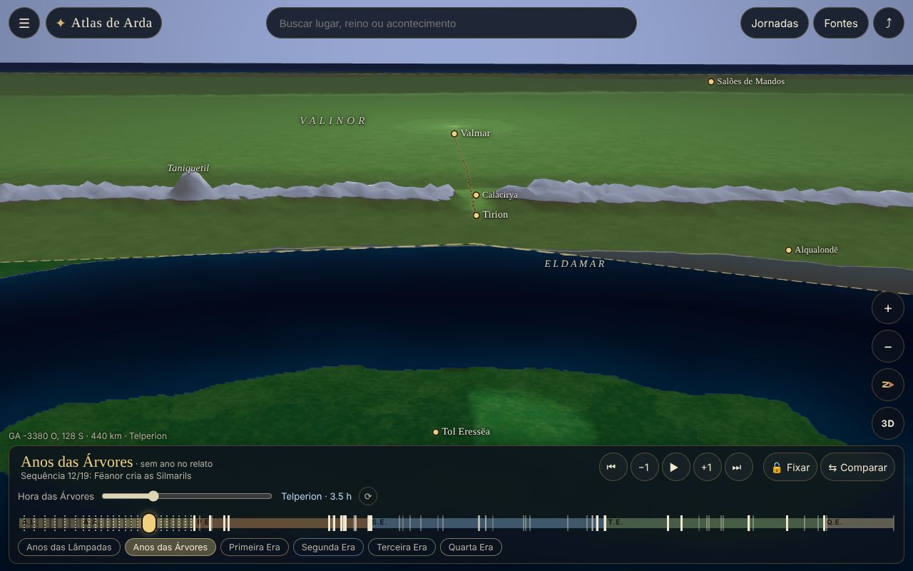
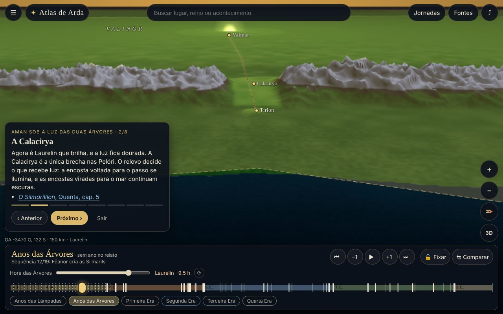
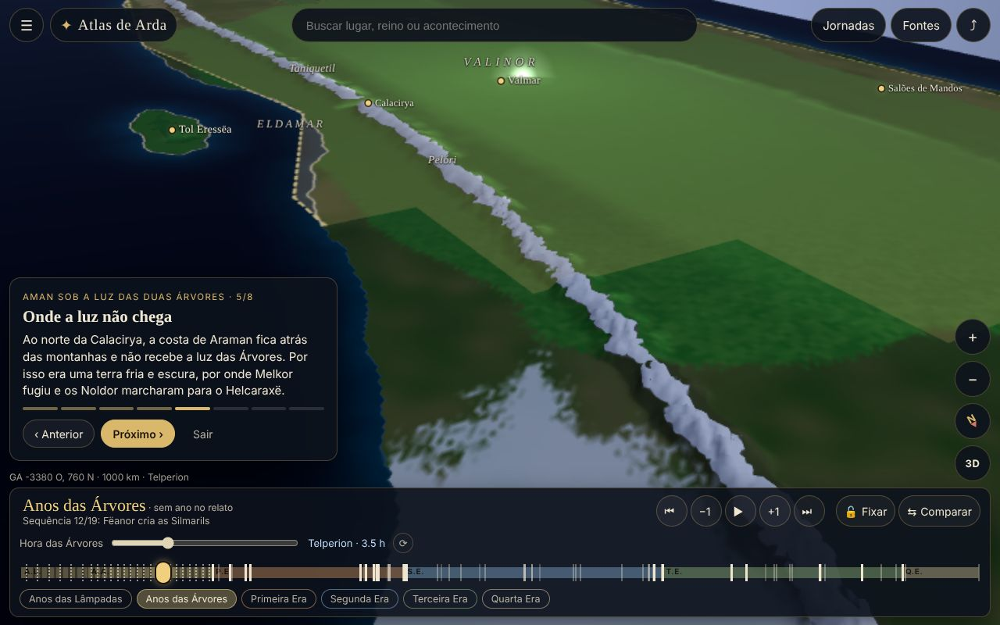
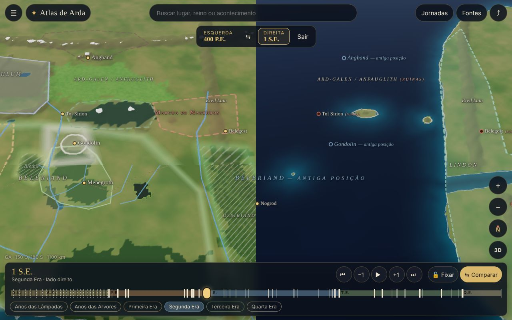
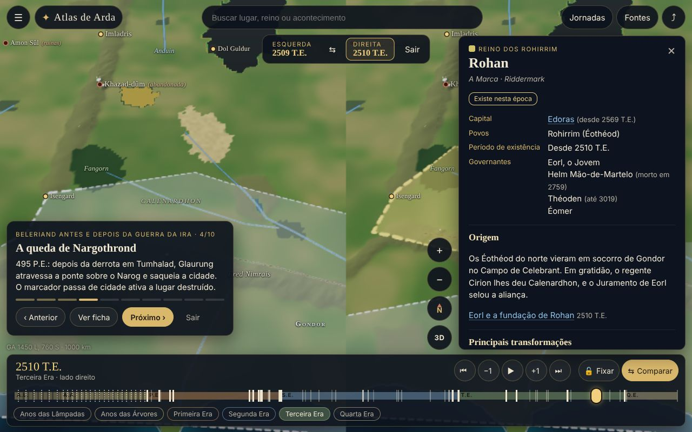
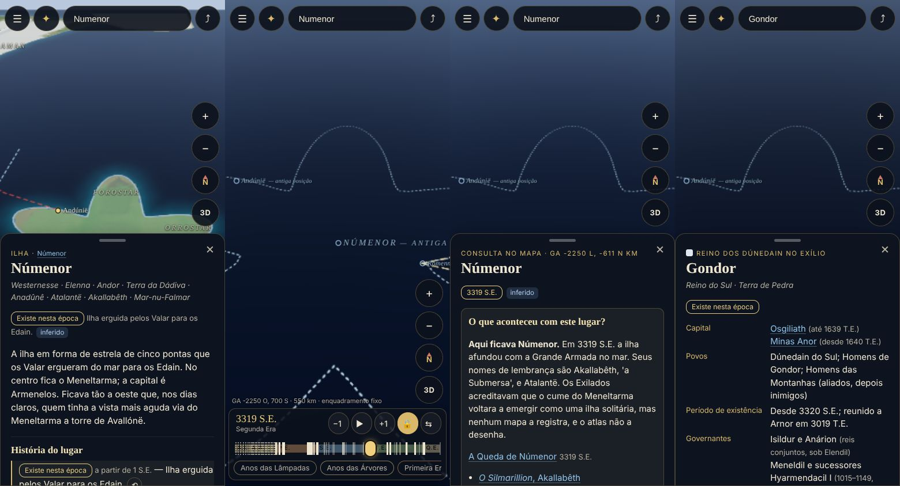

# Atlas de Arda

Atlas 3D, em português do Brasil, para explorar o mundo das histórias de J. R. R. Tolkien. A navegação lembra o Google Earth: o visitante parte de Aman, atravessa o Grande Mar, sobrevoa a Terra-média, aproxima a câmera de uma cidade e move o tempo para ver o que existia ali em outra era.

Em qualquer ponto do mapa, o atlas responde a duas perguntas: **"O que havia aqui nesta época?"** e **"O que aconteceu com este lugar?"**



## Como executar

Requer Node.js 18 ou mais recente e um navegador com WebGL 2.

```bash
npm install
npm run dev        # servidor de desenvolvimento (http://localhost:5173)
npm run validate   # valida a integridade dos dados em data/
npm test           # testes da linha do tempo, dos estados por período e do relevo
npm run build      # valida, verifica tipos, roda os testes e gera a versão estática em dist/
npm run preview    # serve a versão gerada
```

A pasta `dist/` é estática e pode ser publicada em qualquer servidor de arquivos, pois usa caminhos relativos.

## O que já dá para fazer

- **Detalhes dos reinos em 3D — Gondolin.** Em *Camadas e legenda*, escolha *Visitar Gondolin em 3D*. A cidade aparece sobre Amon Gwareth com muralhas, torres, bairros, jardins e fontes. A linha do tempo mostra obras (52–115 P.E.), a cidade íntegra (116–509), ruínas (510–586) e a submersão a partir de 587. A comparação entre épocas também inclui os modelos. A arquitetura é uma reconstrução artística.
- **Detalhes dos reinos em 3D — Minas Tirith.** Em *Camadas e legenda*, escolha *Visitar Minas Tirith em 3D*. Os sete níveis, a muralha negra, os portões alternados, a proa de rocha, a Cidadela e a Torre Branca ficam na encosta do Mindolluin. A linha do tempo mostra a Árvore Branca ausente (antes de 2 T.E.), viva ou morta, conforme as fases do lugar. Veja o [roadmap dos principais reinos](docs/ROADMAP-REINOS-3D.md).

- **Linhagens e governantes.** O botão *Linhagens* (ou *Linhagens e governantes*, no menu ☰) mostra quem governava cada senhorio no momento da linha do tempo. Basta mover o tempo para ver a sucessão mudar: Nargothrond passa de Finrod a Orodreth, e o Alto Reinado dos Noldor vai de Finwë a Gil-galad. Tocar num governante abre a árvore genealógica dele, a começar por Fëanor: ascendência, irmãos e três gerações de descendência. A coroa marca quem reina na época atual, e os retratos de `data/retratos.json` aparecem nos cartões. A ficha de cada reino do mapa ligado a um senhorio também passa a mostrar o governante da época.
- **Abertura em Aman, nos Anos das Árvores.** A câmera mostra a costa de Aman em vista oblíqua, com Tol Eressëa em primeiro plano e as Pelóri ao fundo. Você controla a câmera desde o primeiro instante. O cartão de abertura oferece três ações: *Explorar livremente*, *Escolher uma era* e *Seguir uma jornada*.
- **Luz das Duas Árvores.** Telperion (prata) e Laurelin (ouro) alternam num ciclo de 12 horas, com uma hora de mistura em cada troca. O controle "Hora das Árvores" fica na linha do tempo. Para cada ponto de Aman, o atlas calcula se a luz chega até ele percorrendo o relevo na direção de Ezellohar. Por isso ela passa pela Calacirya, ilumina a margem oeste de Tol Eressëa e deixa Araman e Avathar na sombra das Pelóri. Toque em Ezellohar para alternar entre o florescimento e o escurecimento.
- **Câmera.** Orbitar, inclinar, girar, aproximar no cursor ou com pinça, e voar até um destino buscado, em arco, como num globo virtual.
  - No celular dá para usar uma mão só: um dedo arrasta; toque duplo aproxima; toque duplo seguido de arrasto faz zoom; os botões ficam ao alcance do polegar.
  - Pelo teclado: `←↑→↓` movem, `+`/`−` aproximam, `Q`/`E` giram, `R`/`F` inclinam, `N` aponta para o norte, `[`/`]` mudam o ano, `,`/`.` pulam de acontecimento, `Espaço` reproduz, `L` fixa o enquadramento, `C` compara, `/` busca e `Esc` fecha.
- **Linha do tempo dos Anos das Lâmpadas a 120 da Quarta Era.**
  - Cada era tem largura própria. O tempo avança por ano nas eras datadas. Nas Lâmpadas e nas Árvores, que não têm anos no relato, avança pela sequência dos acontecimentos, e o atlas não inventa anos.
  - Também dá para saltar para um acontecimento, reproduzir uma sequência que pausa nos grandes acontecimentos, ou digitar uma data.
  - **Fixar enquadramento** trava a câmera. Assim, ao mudar a data, você vê o que mudou no mesmo lugar.
- **O mapa se transforma com o tempo.**
  - Quando o relevo muda (Beleriand afunda, Númenor desaparece, o Golfo de Lhûn se abre), os ladrilhos antigos se deformam suavemente até a forma nova.
  - Cidades passam de ativas a destruídas ou submersas, e um aviso mostra o acontecimento e a fonte.
  - Na Queda de Númenor há uma tempestade e o mar ocupa a ilha. Aman e Tol Eressëa deixam a superfície do mundo.
- **Comparação lado a lado** com câmeras sincronizadas: dividida na vertical no computador e na horizontal no celular em retrato. Os *marcos de alinhamento* (Himring/Himling, Dorthonion/Tol Fuin, Ered Luin, Ossiriand/Lindon, Tol Morwen) ajudam a reconhecer o mesmo lugar nas duas paisagens.
- **Fichas de reinos e lugares.**
  - A ficha de um reino traz capital, povos, período, origem, principais transformações e destino, com os comandos *Ver a fundação*, *Ir ao último período conhecido* e *Comparar fronteiras*. Os territórios distinguem domínio político, ocupação e influência, e as bordas podem ser documentadas, aproximadas ou difusas.
  - A ficha de um lugar mostra o estado na época atual, a história, os acontecimentos, o que se sabe e o que é reconstrução, notas de versões e fontes.
- **Busca que encontra lugares desaparecidos.**
  - Buscar Gondolin na Terceira Era oferece *Visitar Gondolin na Primeira Era*.
  - Buscar Númenor depois da Queda oferece a *antiga posição no oceano* e a *ilha durante sua existência*.
- **Links compartilháveis.** O endereço guarda o local, o período, o enquadramento, a seleção, a trava, a comparação e a jornada em curso.
- **Jornadas completas:** *Aman sob a luz das Duas Árvores*, *Beleriand antes e depois da Guerra da Ira* e *Númenor antes e depois da Queda*.
- **O mundo redondo depois da Queda.** A partir de 3319 S.E. o mapa se curva até virar um globo, como conta a Akallabêth. A navegação passa a ser como num globo virtual: arrastar gira a esfera, e ao afastar a câmera aparece o planeta inteiro contra o espaço. O raio adotado é o da Terra (6.371 km), porque depois da Queda o mundo é a Terra e a escala do atlas já segue distâncias reais. Tolkien não dá esse número. A Grade de Arda continua sendo a referência: o mapa é projetado na esfera e gira para que o ponto central da vista fique sempre no topo (`src/render/globo.ts`).
- **Modo narrativo *Seguir o Caminho Reto*.** Depois da Queda, o mundo se curva para baixo enquanto uma estrada de luz segue reta até Aman, mostrada como terra velada. Quem navega pela superfície do mundo não encontra mais Aman.

| | |
|---|---|
|  |  |
|  |  |

## Teste de aceitação (celular)

1. Abra o atlas: ele começa em Aman, nos Anos das Árvores.
2. Busque **Númenor** e toque em *Visitar Númenor — 3318 S.E.*
3. Aproxime até distinguir os cinco promontórios: Forostar, Andustar, Hyarnustar, Hyarrostar e Orrostar.
4. Toque em **🔓 Fixar** e depois em **+1**: o tempo passa de 3318 para 3319 S.E. A ilha afunda e o mar ocupa sua posição, marcada por um contorno pontilhado.
5. Toque na antiga posição. A ficha "Aqui ficava Númenor" explica o que aconteceu e cita a Akallabêth e o Apêndice B. O botão *Voltar à mesma vista antes — 3318 S.E.* restaura a ilha com o mesmo enquadramento.
6. Avance para 3320 S.E. e selecione **Gondor**. A ficha mostra:
   - quem o fundou: Isildur e Anárion, filhos de Elendil;
   - onde surgiu: no Anduin, com Osgiliath entre Minas Ithil e Minas Anor, perto do porto dos Fiéis em Pelargir;
   - como sua história se liga à ilha: a fuga na Queda, a casa de Andúnië e o fruto de Nimloth salvo por Isildur.

   No mapa, as rotas dos navios de Elendil e de seus filhos saem da antiga posição de Númenor.



## Arquitetura

```
data/                 dados separados do código (JSON)
  terreno.json        Grade de Arda, marcos, cadeias de costa e feições de relevo
  eras.json           eras, pesos na linha do tempo, vistas e notas de datação
  eventos.json        acontecimentos (ano ou sequência), lugares, reinos, fontes, certeza
  lugares.json        lugares com fases de existência, destino, aspectos e notas de versão
  reinos.json         reinos com capitais, povos, transformações e territórios por período
  fontes.json         obras, mapas, estudos e índices, com o estado de acesso (inclusive lacunas)
  jornadas.json       percursos guiados
  linhagens.json      pessoas (pais, povo, fontes) e governantes de cada senhorio por período
  retratos.json       retratos, com o que é descrito e o que é interpretação
src/
  core/time.ts        linha do tempo unificada (anos e sequências), referências temporais
  core/data.ts        carga dos dados, validade por período, estados de lugares e territórios
  core/linhagens.ts   parentescos, uniões, ascendência e governante de cada senhorio no instante t
  terrain/model.ts    função de relevo: costas fractais, distâncias, montanhas, rios, biomas
  terrain/terrain.worker.ts  geração de ladrilhos e da visibilidade da luz das Árvores
  terrain/tiles.ts    quadtree com carregamento progressivo e transição (morph) entre eras
  terrain/material.ts shader: biomas, água, neve, luz do Sol, das Árvores e das Lâmpadas, névoa
  render/             câmera, céu, iluminação por período, camadas vetoriais, rótulos
  ui/                 linha do tempo, busca, fichas, painel, camadas, jornadas, links
tests/                testes (Vitest): tempo, estados dos lugares e reinos, relevo por período
scripts/
  validate-data.mjs   verificação de ids, referências cruzadas, tempos e fontes
  formatar-dados.mjs  formata terreno.json com uma feição por linha
  numenor-contorno.mjs gera o contorno estrelado de Númenor a partir da descrição
```

O relevo não vem de imagens prontas. Ele é uma função calculada a partir de dados vetoriais:

1. As costas são polígonos montados com **cadeias compartilhadas** entre eras. A costa da Terceira Era a leste das Ered Luin, por exemplo, é a mesma em todos os períodos. Uma subdivisão fractal determinística dá às costas um traçado natural.
2. Um índice espacial calcula a distância de cada ponto até a costa.
3. Sobre essa base entram cordilheiras (perfis com ruído em cristas), picos, passos (como a Calacirya), planaltos, bacias (como Tumladen), vales de rios, lagos, florestas e biomas.
4. Cada feição tem um período de validade, e o conjunto ativo num instante gera uma *assinatura*. Os ladrilhos são gerados em workers, primeiro os grosseiros e depois os detalhados perto da câmera.
5. Quando a assinatura muda, cada ladrilho novo parte das alturas antigas e se deforma até as novas.

### Como ampliar a cobertura

- **Novo lugar:** acrescente um objeto em `data/lugares.json` com `id`, `nome`, `tipo`, `em` (coordenadas na Grade de Arda), `posto` (de 1 a 5, a importância do rótulo), `de`/`ate` ou `fases`, `resumo`, `fontes` e `cert`. Use `aspectos` para separar o que é descrito do que é reconstrução.
- **Novo reino:** use `data/reinos.json`. Cada território tem `tipo` (`dominio`, `ocupacao` ou `influencia`), `borda` (`documentada`, `aproximada` ou `difusa`) e período.
- **Novo acontecimento:** use `data/eventos.json`. Nas eras sem datas, use `seq` e não `ano`. Nas eras datadas, quando a data é incerta, use `aprox` e `nota_data`.
- **Nova feição de relevo:** use `data/terreno.json`. Os tipos são `terra`, `cordilheira`, `pico`, `passo`, `planalto`, `bacia`, `lago`, `rio`, `floresta`, `bioma`, `gelo`, `estrada` e `zona` (grau de certeza).
- Rode `npm run validate` antes de publicar.

**Referências temporais** valem em todos os arquivos: `"SE:3319"` (ano), `"AA:#aa-escurecimento"` (acontecimento), `"PE:inicio"`, `"-inf"` e `"+inf"`. Um intervalo `de`/`ate` inclui o início e exclui o fim.

## Método, fontes e grau de certeza

**Grade de Arda.** Coordenadas em quilômetros, com x para leste e y para norte. A origem fica em Himring, que vira a ilha de Himling depois da Primeira Era. Os mapas de épocas diferentes foram encaixados por marcos compartilhados.

A escala foi calibrada com indicações textuais e com as anotações de Tolkien no mapa de Pauline Baynes:

- O Sirion corre 130 léguas do Passo à foz (*O Silmarillion*, cap. 14).
- Minas Tirith fica a cerca de 900 milhas de Hobbiton, na latitude de Ravena; Hobbiton está na de Oxford.

A largura do Belegaer e a forma de Aman seguem só as proporções dos mapas da Ambarkanta, por isso estão marcadas como inferência ou reconstrução.

**Três graus de certeza**, registrados em cada feição, acontecimento, lugar e aspecto:

- **Descrito:** desenhado ou descrito por Tolkien.
- **Inferido:** deduzido de referências, como a posição de Númenor ou os anos da Primeira Era tirados dos Anais Cinzentos.
- **Reconstrução artística:** necessária para a paisagem, sem apoio direto nas fontes, como altitudes, larguras de rios e o extremo leste.

A camada *Certeza cartográfica* hachura as áreas de reconstrução. Nessas regiões o relevo também tem menos detalhe e menos saturação.

**Versões do legendário.** A narrativa principal é a do *Silmarillion* publicado, inclusive a Akallabêth para a Queda de Númenor. Versões alternativas aparecem em notas identificadas nas fichas: *A Queda de Númenor*, *The Drowning of Anadûnê*, a carta 131 e a tradição da Ilha de Meneltarma.

**Lacunas registradas.** Algumas fontes não foram consultadas diretamente nesta versão e aparecem como **lacuna** em `data/fontes.json` e na ficha *Fontes e método*:

- os volumes IV, V, IX, X e XI de *The History of Middle-earth*, que trazem a Ambarkanta, as versões da Queda, os Anais de Aman e os Anais Cinzentos;
- *The Nature of Middle-earth* e *The Fall of Númenor*;
- o atlas de Karen Wynn Fonstad;
- o *Complete Guide* de Robert Foster;
- o site do Tolkien Estate.

Datas e detalhes que dependem dessas obras foram conferidos em índices especializados (Tolkien Gateway, Encyclopedia of Arda) e estão marcados como *inferido*. Os textos de *O Silmarillion* e de *O Senhor dos Anéis* foram usados a partir de conhecimento prévio das obras e devem ser cotejados com as edições impressas.

**Direitos.** Todos os textos do atlas são resumos próprios. Relevo, texturas e cores são gerados por código a partir dos dados deste projeto, e nenhum mapa, ilustração ou trecho protegido foi reproduzido. Os nomes e o mundo de Arda pertencem à obra de J. R. R. Tolkien e a seus detentores de direitos.

## Limitações conhecidas e próximos passos

- Fora de Aman, Beleriand, Númenor e do noroeste da Terra-média, a cobertura é esquemática: o leste e o sul estão marcados como reconstrução.
- Os territórios usam polígonos simplificados. Faltam vários períodos intermediários, como as conquistas de Angmar ano a ano e as fronteiras de Gondor sob cada rei.
- Os Anos das Lâmpadas têm só uma geografia esquemática.
- O relevo é procedural: os rios escavam vales, mas o atlas não simula drenagem.
- O desempenho depende da GPU. Em aparelhos modestos o atlas reduz a resolução automaticamente; o parâmetro `?qualidade=fixa` desativa esse ajuste.
- Próximos passos possíveis: consultar diretamente as fontes registradas como lacuna, ampliar os reinos da Terceira Era, acrescentar jornadas (a Guerra do Anel, a queda de Arnor) e oferecer navegação acessível alternativa, como uma lista de lugares por era.
