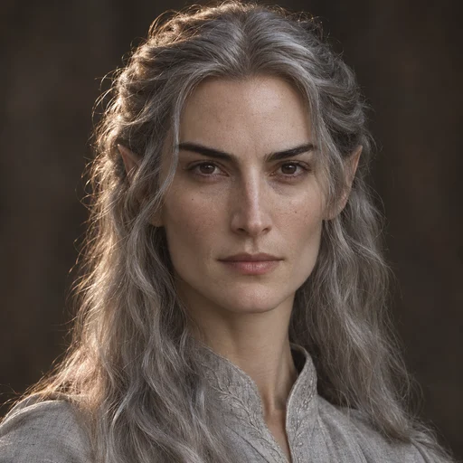
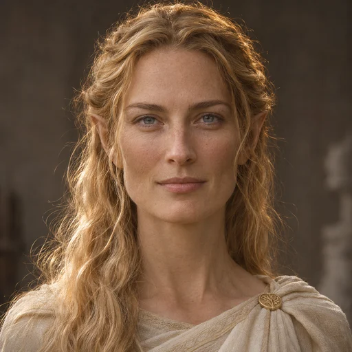

# Retratos — etapa 1: família imediata de Fëanor

Entrega em 7 de novembro de 2026: **Finwë, Míriel Serindë, Indis, Mahtan e Celebrimbor**, gerados pela ferramenta image_gen integrada e cadastrados diretamente no OpenArda. O catálogo passa a ter 14 retratos.

Os novos arquivos estão em `public/retratos/<id>.webp`, com 512 × 512 pixels e aproximadamente 181 KiB no total. Os nove retratos anteriores foram preservados.

## Galeria e decisões literárias

| Personagem | Retrato | Decisão |
| --- | --- | --- |
| Finwë |  | Cabelos negros e olhos azul-acinzentados; feições familiares variam a referência de Fëanor. [Fonte consultada](https://tolkiengateway.net/wiki/Finw%C3%AB). |
| Míriel Serindë |  | Cabelos prateados e olhos escuros na tradição de Morgoth’s Ring. A versão de cabelo escuro de The Nature of Middle-earth fica registrada como alternativa. [Fonte consultada](https://tolkiengateway.net/wiki/M%C3%ADriel). |
| Indis |  | Cabelos dourados; olhos e anatomia facial interpretativos. Nerdanel serviu somente como referência de fotografia, sem parentesco inferido entre elas. [Fonte consultada](https://tolkiengateway.net/wiki/Indis). |
| Mahtan |  | Cabelos castanho-avermelhados, barba e diadema de cobre; semelhança familiar derivada de Nerdanel. [Fonte consultada](https://tolkiengateway.net/wiki/Mahtan). |
| Celebrimbor |  | Segue a filiação a Curufin adotada pelo projeto. Cabelo, olhos e semelhança facial são inferências, não descrição física individual localizada. [Fonte consultada](https://tolkiengateway.net/wiki/Celebrimbor). |

As características documentadas e inferidas e as referências às obras estão em [data/retratos.json](../data/retratos.json). As obras foram consultadas por remissões do Tolkien Gateway, sem cotejo direto das edições impressas nesta entrega. Idade aparente, roupas e geometria facial são interpretações artísticas.

Os [prompts completos e referências visuais](retratos-etapa-1-prompts.json) registram a geração. As imagens originais permanecem no diretório de imagens geradas da sessão; a aplicação usa exclusivamente os WebP dentro do projeto.

## Integração

A interface existente consulta os retratos pelo ID por meio de `retratoDe`. Os cinco novos registros usam os IDs já presentes em `linhagens.json`; não houve mudança de parentesco, layout ou dependências.

Cada retrato aparece no cabeçalho da ficha individual (96 × 96) e no cartão da árvore (36 × 36), com o mesmo comportamento dos nove anteriores. As imagens nos cartões continuam decorativas por acompanharem o nome; o retrato principal usa o texto alternativo do cadastro. Ascendência e irmãos mantêm o padrão de links já existente.

Para conferir na aplicação, abra a ficha da pessoa ou use `#s=linhagem:finwe`, `#s=linhagem:miriel`, `#s=linhagem:indis`, `#s=linhagem:mahtan` e `#s=linhagem:celebrimbor` no endereço do atlas.

## Verificação

- `npm run build`: dados válidos, TypeScript, **68 testes aprovados** e build Vite concluído.
- Cinco testes verificam os retratos da etapa 1 na ficha e no cartão, usando o renderizador real da interface.
- Arquivos decodificados, dimensões 512 × 512, formato WebP e tamanho inferior a 100 KiB por imagem.
- Arquivos copiados para `dist/` idênticos aos de `public/` e respostas HTTP 200 com o conteúdo WebP correto no servidor local.
- As primeiras nove entradas do catálogo foram preservadas.

As imagens geradas foram inspecionadas visualmente. A conferência visual da página no navegador não foi concluída: a automação falhou ao navegar para a prévia local. Esta entrega altera o projeto e o build local; não inclui publicação na VPS.
