# Retratos — etapa 2: O Senhor dos Anéis

Produção de **7 de novembro de 2026**, integrada ao padrão de retratos do OpenArda. **24 de 24 retratos integrados**. Gandalf foi concluído pela API local configurada no HopeGym, durante a entrega da etapa 3, após as recusas registradas na tentativa inicial.

Cada imagem usa a caracterização do ator na trilogia original de Peter Jackson (2001–2003), com uma composição fotográfica nova: fundo discreto, iluminação suave e enquadramento para miniaturas. O primeiro retrato de Bilbo representa Ian Holm idoso; a versão jovem de Martin Freeman não substitui esta época.

## Galeria e referências

| Personagem | Retrato | Intérprete e filme de referência | Época visual |
| --- | --- | --- | --- |
| Galadriel | 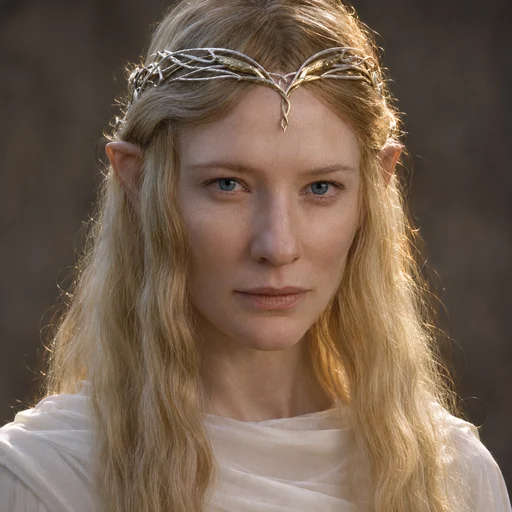 | Cate Blanchett — [2001](https://tolkiengateway.net/wiki/The_Lord_of_the_Rings:_The_Fellowship_of_the_Ring); [imagem consultada](https://www.moma.org/calendar/events/1526) | Lórien, Guerra do Anel |
| Celeborn | 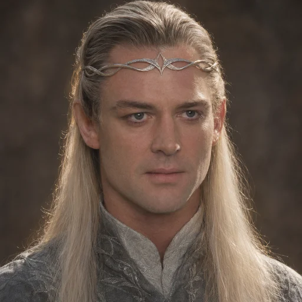 | Marton Csokas — [2001](https://tolkiengateway.net/wiki/The_Lord_of_the_Rings:_The_Fellowship_of_the_Ring); [imagem consultada](https://www.imdb.com/title/tt0120737/mediaviewer/rm1792861184/) | Lórien, Guerra do Anel |
| Elrond | 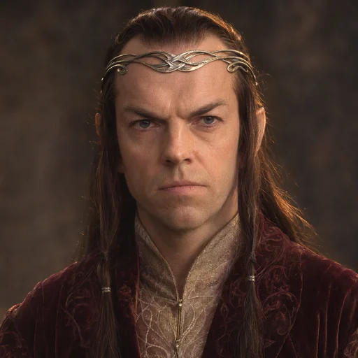 | Hugo Weaving — [2001](https://tolkiengateway.net/wiki/The_Lord_of_the_Rings:_The_Fellowship_of_the_Ring); [imagem consultada](https://www.imdb.com/media/rm2578022400/tt0120737) | Imladris, Conselho de Elrond |
| Arwen Undómiel | 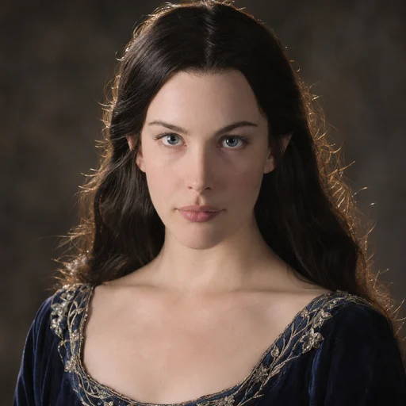 | Liv Tyler — [2003](https://tolkiengateway.net/wiki/The_Lord_of_the_Rings:_The_Return_of_the_King); [imagem consultada](https://www.imdb.com/title/tt0167260/mediaviewer/rm1245822209/) | Imladris, Guerra do Anel |
| Aragorn II Elessar | 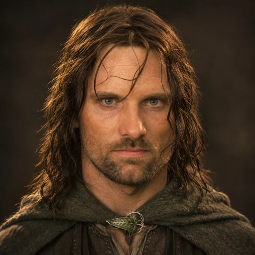 | Viggo Mortensen — [2001](https://tolkiengateway.net/wiki/The_Lord_of_the_Rings:_The_Fellowship_of_the_Ring); [imagem consultada](https://www.independent.co.uk/arts-entertainment/films/news/lotr-viggo-mortensen-leo-woodall-b2934355.html) | Passolargo, Guerra do Anel |
| Frodo Bolseiro | 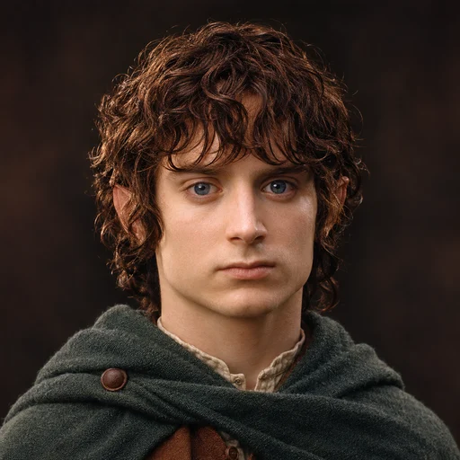 | Elijah Wood — [2001](https://tolkiengateway.net/wiki/The_Lord_of_the_Rings:_The_Fellowship_of_the_Ring); [imagem consultada](https://www.imdb.com/title/tt0120737/mediaviewer/rm2297981696) | Condado e início da Sociedade |
| Samwise Gamgi | 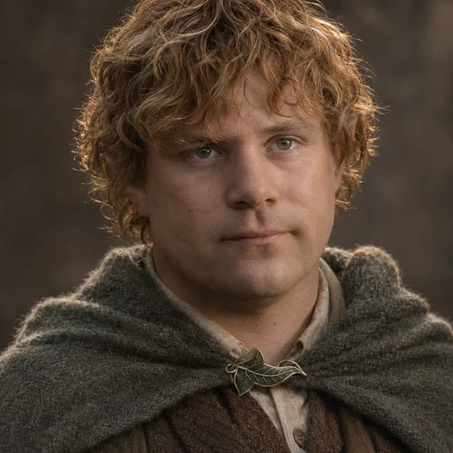 | Sean Astin — [2001](https://tolkiengateway.net/wiki/The_Lord_of_the_Rings:_The_Fellowship_of_the_Ring); [imagem consultada](https://www.looper.com/230806/how-old-is-each-member-of-the-fellowship-of-the-ring/) | Sociedade, Guerra do Anel |
| Meriadoc Brandebuque | 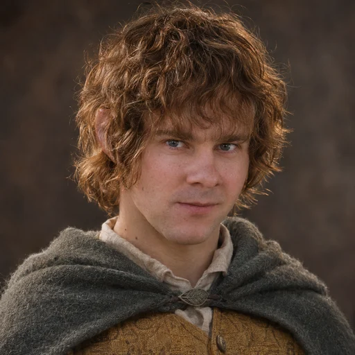 | Dominic Monaghan — [2001](https://tolkiengateway.net/wiki/The_Lord_of_the_Rings:_The_Fellowship_of_the_Ring); [imagem consultada](https://parade.com/movies/lord-of-the-rings-cast-where-are-they-now) | Sociedade, Guerra do Anel |
| Peregrin Tûk | 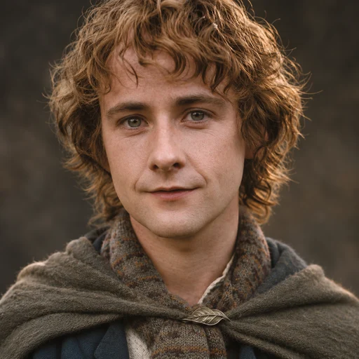 | Billy Boyd — [2001](https://tolkiengateway.net/wiki/The_Lord_of_the_Rings:_The_Fellowship_of_the_Ring); [imagem consultada](https://ar.pinterest.com/pin/710724384926408460/) | Sociedade, Guerra do Anel |
| Gandalf | 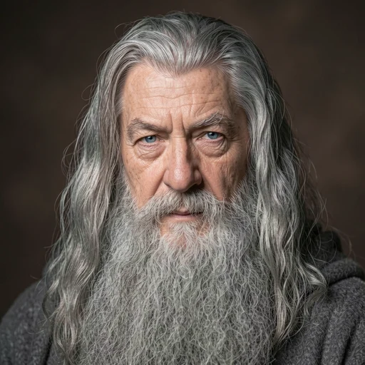 | Ian McKellen — [2001](https://tolkiengateway.net/wiki/The_Lord_of_the_Rings:_The_Fellowship_of_the_Ring); [imagem consultada](https://www.pinterest.com/pin/31032684904607376/) | Gandalf, o Cinzento, antes de Moria |
| Legolas | 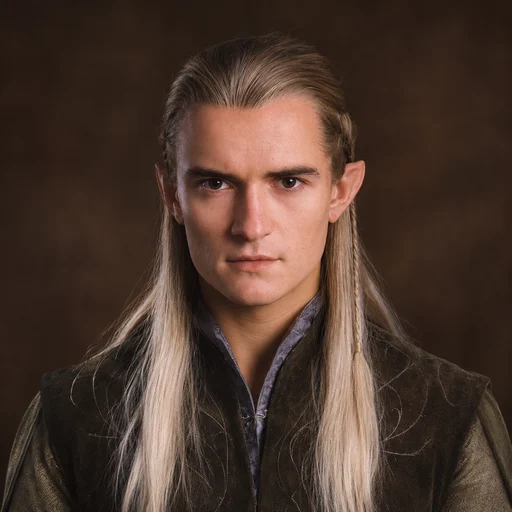 | Orlando Bloom — [2001](https://tolkiengateway.net/wiki/The_Lord_of_the_Rings:_The_Fellowship_of_the_Ring); [imagem consultada](https://www.elfenomeno.com/en/info/ver/2713/photo-of-legolas-in-action-magazine) | Sociedade, Guerra do Anel |
| Gimli | 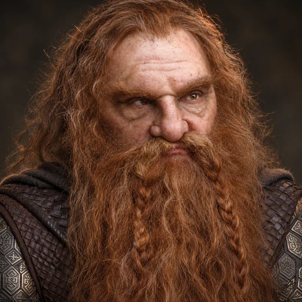 | John Rhys-Davies — [2001](https://tolkiengateway.net/wiki/The_Lord_of_the_Rings:_The_Fellowship_of_the_Ring); [imagem consultada](https://www.tmz.com/2020/09/16/john-rhys-davies-gimli-lord-of-the-rings-then-and-now-photos/) | Sociedade, Guerra do Anel |
| Boromir | 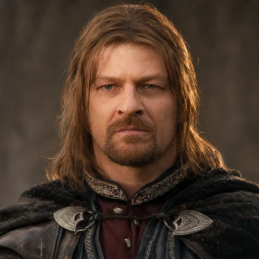 | Sean Bean — [2001](https://tolkiengateway.net/wiki/The_Lord_of_the_Rings:_The_Fellowship_of_the_Ring); [imagem consultada](https://www.infobae.com/entretenimiento/2026/02/17/vestuario-epico-mas-de-2000-metros-de-montana-y-un-reto-fuera-del-guion-asi-sean-bean-llevo-a-boromir-a-su-final-en-el-senor-de-los-anillos/) | Sociedade, antes de Amon Hen |
| Bilbo Bolseiro | 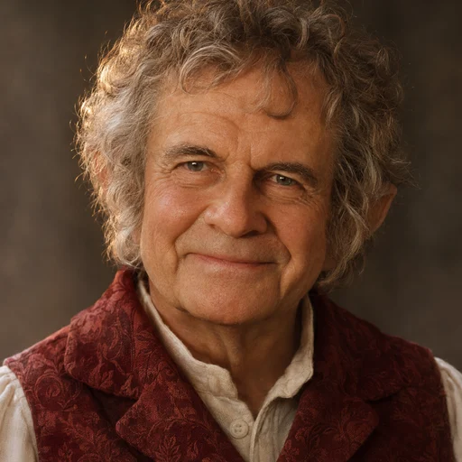 | Ian Holm — [2001](https://tolkiengateway.net/wiki/The_Lord_of_the_Rings:_The_Fellowship_of_the_Ring); [imagem consultada](https://www.moviepilot.de/news/bilbo-aus-der-herr-der-ringe-schauspieler-ian-holm-ist-tot-1127820) | Bilbo idoso, festa de aniversário |
| Faramir | 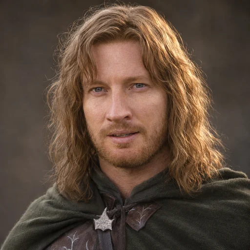 | David Wenham — [2002](https://tolkiengateway.net/wiki/The_Lord_of_the_Rings:_The_Two_Towers); [imagem consultada](https://www.moviepilot.de/people/david-wenham) | Capitão de Gondor, Guerra do Anel |
| Denethor II | 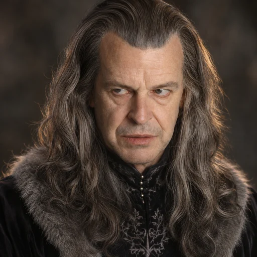 | John Noble — [2003](https://tolkiengateway.net/wiki/The_Lord_of_the_Rings:_The_Return_of_the_King); [imagem consultada](https://www.facts.be/en/) | Regente de Gondor, Guerra do Anel |
| Théoden | 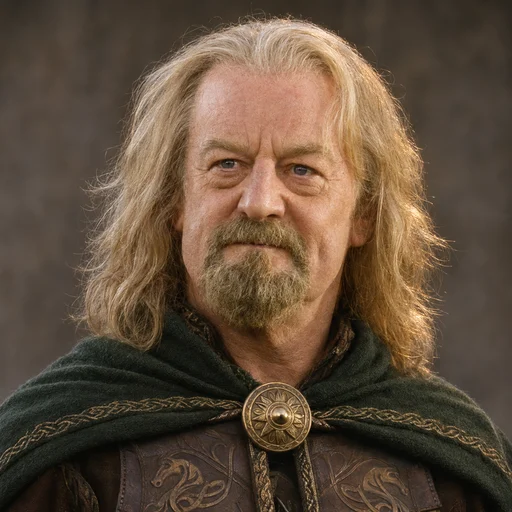 | Bernard Hill — [2002](https://tolkiengateway.net/wiki/The_Lord_of_the_Rings:_The_Two_Towers); [imagem consultada](https://onedio.co/content/mourning-the-loss-of-a-legend-bernard-hill-king-theoden-in-the-lord-of-the-rings-passes-away-at-79-27143) | Rei de Rohan após a libertação |
| Éomer | 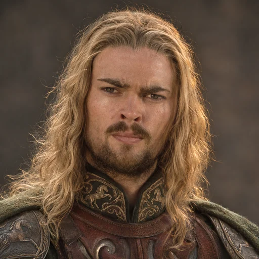 | Karl Urban — [2002](https://tolkiengateway.net/wiki/The_Lord_of_the_Rings:_The_Two_Towers); [imagem consultada](https://www.pinterest.com/pin/1125968637432028/) | Cavaleiro de Rohan, Guerra do Anel |
| Éowyn | 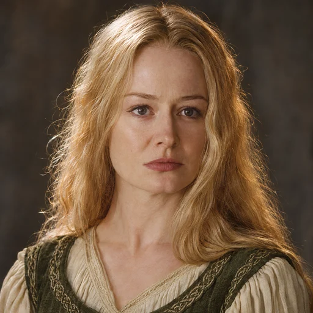 | Miranda Otto — [2003](https://tolkiengateway.net/wiki/The_Lord_of_the_Rings:_The_Return_of_the_King); [imagem consultada](https://www.listal.com/viewimage/7937260) | Éowyn, Guerra do Anel |
| Saruman | 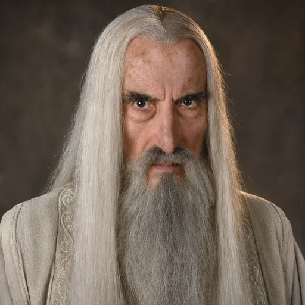 | Christopher Lee — [2001](https://tolkiengateway.net/wiki/The_Lord_of_the_Rings:_The_Fellowship_of_the_Ring); [imagem consultada](https://jrrtolkien.fr/galerie/film-les-deux-tours-avatar-saroumane.html) | Saruman, o Branco, em Isengard |
| Gollum / Sméagol | 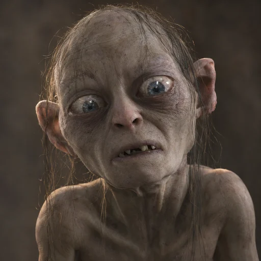 | Andy Serkis — [2002](https://tolkiengateway.net/wiki/The_Lord_of_the_Rings:_The_Two_Towers); [imagem consultada](https://www.imdb.com/title/tt0167261/characters/nm0785227/) | Gollum transformado, Guerra do Anel |
| Sauron | 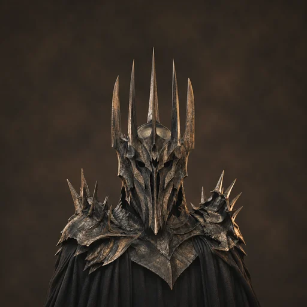 | Sala Baker — [2001](https://tolkiengateway.net/wiki/The_Lord_of_the_Rings:_The_Fellowship_of_the_Ring); [imagem consultada](https://www.3djuegos.com/tv-series/noticias/te-diste-cuenta-tienes-vista-elfo-paras-senor-anillos-minuto-1-54-descubriras-sauron-referencias-oscuras-nunca-vistas-pelicula) | Última Aliança, prólogo cinematográfico |
| Rei-bruxo de Angmar | 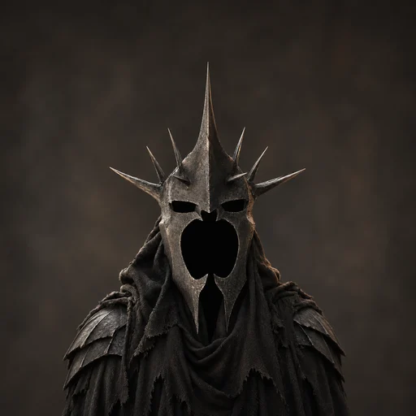 | Lawrence Makoare — [2003](https://tolkiengateway.net/wiki/The_Lord_of_the_Rings:_The_Return_of_the_King); [imagem consultada](https://m.imdb.com/title/tt0167260/mediaviewer/rm372153345/) | Pelennor, O Retorno do Rei |
| Gríma Língua de Cobra | 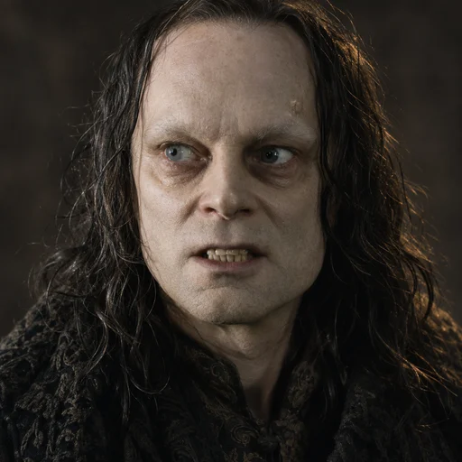 | Brad Dourif — [2002](https://tolkiengateway.net/wiki/The_Lord_of_the_Rings:_The_Two_Towers); [imagem consultada](https://entretenimento.uol.com.br/noticias/redacao/2020/07/23/chucky-dublador-classico-do-brinquedo-assassino-retornara-para-serie.htm) | Meduseld, As Duas Torres |

## Pesquisa e decisões

A pesquisa literária foi feita **por fontes secundárias**, nas páginas de personagens de Tolkien Gateway e suas remissões aos livros; não houve consulta direta a uma edição física ou digital das obras. O catálogo [data/retratos.json](../data/retratos.json) separa os traços documentados das escolhas cinematográficas e artísticas. A identidade do ator e a época são registradas em `referencia_cinematografica`.

- Galadriel conserva o dourado com reflexos prateados; Celeborn, o cabelo prateado. Elrond e Arwen têm cabelo escuro. As identidades faciais seguem os filmes.
- O cabelo mais claro e as barbas de Boromir e Faramir seguem Sean Bean e David Wenham; suas descrições literárias registram cabelo escuro. A ausência de barba de Faramir em texto complementar também está anotada.
- O loiro de Legolas é uma escolha cinematográfica. Não foi localizado, nas fontes consultadas, um enunciado inequívoco sobre a cor individual de seu cabelo em Tolkien.
- Gríma segue os olhos claros de Brad Dourif; o texto registra olhos escuros. Théoden segue a caracterização de Bernard Hill após sua libertação, com a diferença em relação ao cabelo branco e à barba longa do texto anotada.
- Gimli usa a caracterização com próteses de John Rhys-Davies. Gollum usa a criatura digital interpretada por Andy Serkis, sem substituí-la pelo rosto humano do ator.
- Sauron usa a armadura e o elmo da Última Aliança, no prólogo de *A Sociedade do Anel*: é uma imagem da **Segunda Era**, mesmo quando a ficha é aberta em outro ponto da cronologia. O Rei-bruxo usa o elmo do Pelennor com vazio sob a máscara. Nenhum dos dois recebeu um rosto humano inventado.

Fontes de elenco: [A Sociedade do Anel (2001)](https://tolkiengateway.net/wiki/The_Lord_of_the_Rings:_The_Fellowship_of_the_Ring), [As Duas Torres (2002)](https://tolkiengateway.net/wiki/The_Lord_of_the_Rings:_The_Two_Towers) e [O Retorno do Rei (2003)](https://tolkiengateway.net/wiki/The_Lord_of_the_Rings:_The_Return_of_the_King).

Os [prompts e URLs das imagens consultadas](retratos-etapa-2-prompts.json) estão preservados por personagem. As fotografias de referência foram usadas como insumo de identidade e não são distribuídas como arquivos da aplicação. Os originais gerados permanecem no diretório de imagens geradas da sessão; a aplicação recebe somente os WebP finais.

## Integração

Foram reaproveitados `data/retratos.json`, `retratoDe(id)` e os componentes de ficha e árvore existentes. Os arquivos finais ficam em `public/retratos/<id>.webp`. Os grupos Hobbit, Anão e Homem foram acrescentados aos tipos, à validação e às cores existentes, sem dependências novas.

Os 24 personagens da etapa têm ficha; 19 foram acrescentados para esta entrega. A ligação Denethor → Boromir/Faramir foi registrada sem confundir Finduilas de Dol Amroth com a Finduilas de Nargothrond já cadastrada. Não foram inventados pais para preencher os ramos ausentes. Os 14 retratos das etapas anteriores foram preservados.

## Verificação

- `npm run build` aprovado: validação de dados, TypeScript, **129 testes** e build de produção.
- Os **37 WebP** do catálogo foram decodificados, medem 512 × 512 e carregam com HTTP 200 e conteúdo idêntico ao arquivo local. Os **23 novos** somam **926.484 bytes**; o maior tem **69.032 bytes**, abaixo da meta de 100 KiB.
- Testes verificam todos os retratos no cabeçalho da ficha (96 px), nos cartões (36 px) e no cabeçalho da árvore em tela cheia (56 px). O validador de dados agora verifica a presença dos arquivos.
- As 23 imagens foram inspecionadas e comparadas em montagem com recortes circulares de 96 px e 36 px. Os elmos de Sauron e do Rei-bruxo foram reenquadrados para manter as pontas visíveis.
- Conferência visual da página em computador e celular: pendente; a automação do Chrome falha ao criar uma aba (`timeoutMs`).

## Gandalf — pendência resolvida

O retrato previsto é Ian McKellen como Gandalf, o Cinzento, antes de Moria. A ferramenta de imagens recusou a geração três vezes, incluindo uma composição nova sem imagem de entrada. A tentativa adicional pela API, autorizada pelo usuário e feita com a chave configurada localmente, retornou erro 400 de recusa pelo sistema de segurança. Essas tentativas não produziram arquivo. Após a preferência do usuário pela API local, o retrato foi gerado com ComfyUI/FLUX.2 Klein 9B, inspecionado e integrado em `public/retratos/gandalf.webp`. A identidade visual continua sendo Ian McKellen como o Cinzento.

A etapa 2 agora tem **24 personagens pesquisados e 24 retratos integrados**. As verificações finais foram executadas junto à [etapa 3](RETRATOS-ETAPA-3.md). A conferência visual da página permanece limitada pela disponibilidade da automação do navegador. Esta entrega não publica o projeto na VPS.
