# Retratos — etapa 3: Casa de Finwë, Gondolin e Nargothrond

Entrega de **7 de novembro de 2026**: **20 retratos integrados** à interface existente, mais a conclusão de **Gandalf**, pendente da etapa 2. O catálogo alcança **58 retratos**.

Toda a geração desta entrega utilizou a **API local ComfyUI, FLUX.2 Klein 9B**, reutilizando o cliente e a configuração do HopeGym. A alternativa pela API do GPT não foi necessária. A preferência local → GPT está registrada no [roadmap](ROADMAP-RETRATOS-PERSONAGENS.md) e no AGENTS.md local. Nenhum serviço ou catálogo do HopeGym foi alterado.

## Galeria, época e base literária

| Personagem | Retrato | Época | Base documentada e fonte consultada |
| --- | --- | --- | --- |
| Fingolfin | 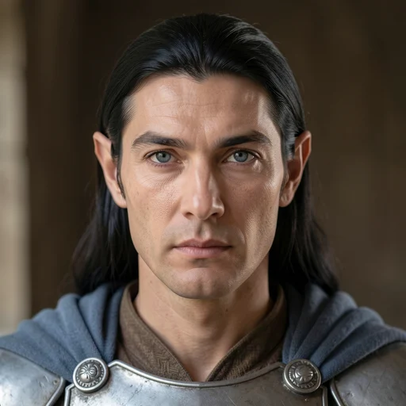 | Hithlum, antes da Dagor Bragollach | Filho de Finwë e Indis. Cabelo longo e escuro; armadura prateada no combate com Morgoth. [Fonte](https://tolkiengateway.net/wiki/Fingolfin) |
| Finarfin | 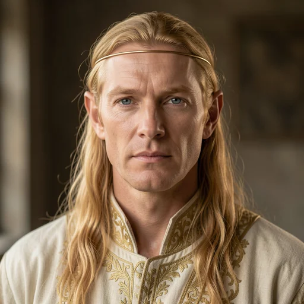 | Tirion, rei dos Noldor que permaneceram em Aman | Filho de Finwë e Indis. Cabelo dourado herdado dos Vanyar de Indis. [Fonte](https://tolkiengateway.net/wiki/Finarfin) |
| Olwë | 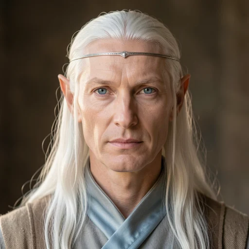 | Alqualondë, antes do Fratricídio | Senhor dos Teleri de Alqualondë e pai de Eärwen. Cabelo longo e branco e olhos azuis. [Fonte](https://tolkiengateway.net/wiki/Olw%C3%AB) |
| Eärwen | 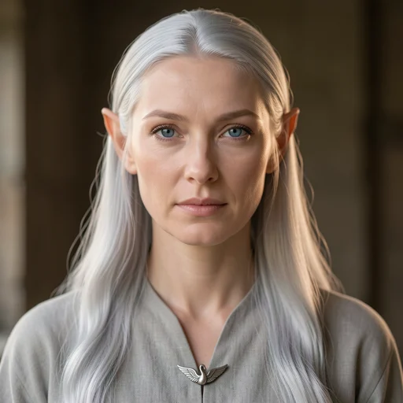 | Aman, esposa de Finarfin | Filha de Olwë e esposa de Finarfin. Cabelo prateado comparado à luz das estrelas. [Fonte](https://tolkiengateway.net/wiki/E%C3%A4rwen) |
| Anairë | 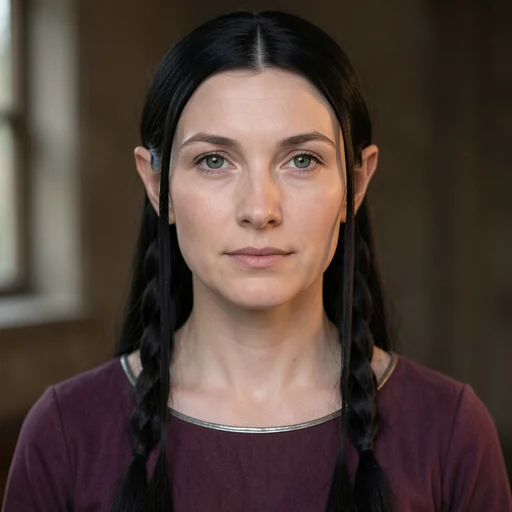 | Tirion, permaneceu em Aman | Noldo, esposa de Fingolfin e mãe de Fingon, Turgon e Aredhel; permaneceu em Aman. [Fonte](https://tolkiengateway.net/wiki/Anair%C3%AB) |
| Fingon | 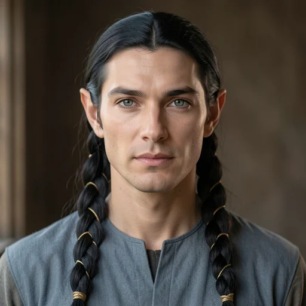 | Hithlum, antes da Nirnaeth Arnoediad | Filho de Fingolfin e Anairë. Cabelo longo e escuro em grandes tranças entretecidas de ouro. [Fonte](https://tolkiengateway.net/wiki/Fingon) |
| Turgon | 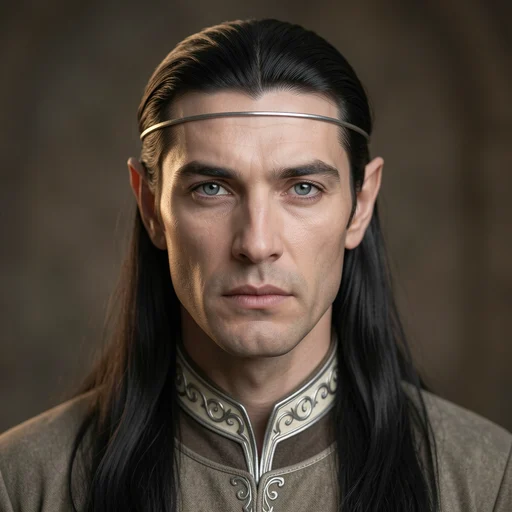 | Gondolin, antes da queda | Filho de Fingolfin e Anairë, esposo de Elenwë e pai de Idril. Estatura excepcional, superada por Thingol. [Fonte](https://tolkiengateway.net/wiki/Turgon) |
| Elenwë | 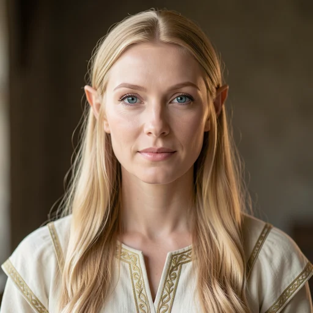 | Aman, antes da travessia do Helcaraxë | Vanya, esposa de Turgon e mãe de Idril. Cabelo dourado transmitido à filha. [Fonte](https://tolkiengateway.net/wiki/Elenw%C3%AB) |
| Aredhel | 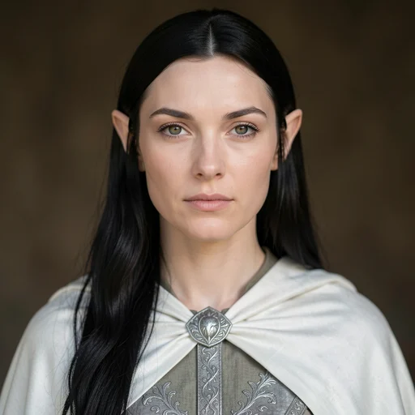 | Gondolin, antes da partida para Nan Elmoth | Filha de Fingolfin e Anairë. Cabelo escuro, pele pálida e vestes prateadas e brancas. [Fonte](https://tolkiengateway.net/wiki/Aredhel) |
| Idril Celebrindal | 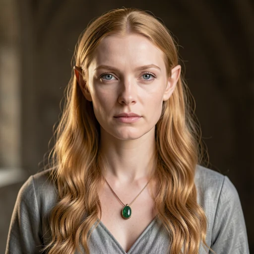 | Gondolin, adulta antes da queda | Filha de Turgon e Elenwë. Cabelo dourado comparado ao ouro de Laurelin. [Fonte](https://tolkiengateway.net/wiki/Idril) |
| Eöl | 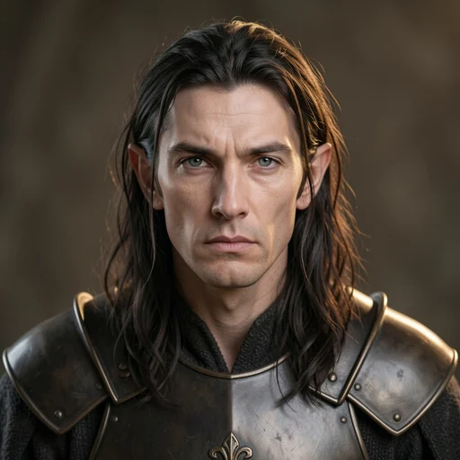 | Nan Elmoth, antes de seguir Aredhel | Ferreiro de Nan Elmoth, parente de Thingol e pai de Maeglin. Cabelo escuro; porte encurvado pelo trabalho da forja e uso de galvorn nas viagens. [Fonte](https://tolkiengateway.net/wiki/E%C3%B6l) |
| Maeglin | 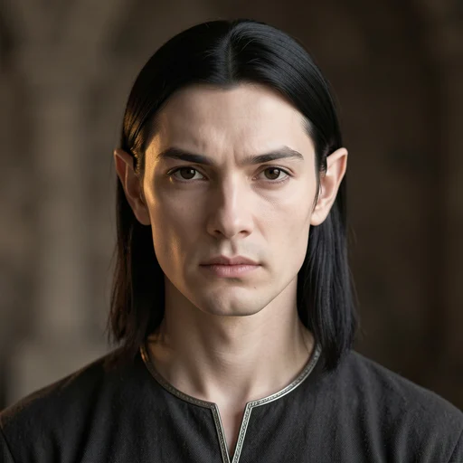 | Gondolin, adulto antes da traição | Filho de Eöl e Aredhel, semelhante em rosto e forma à parentela Noldor da mãe. Cabelo negro e olhos escuros. [Fonte](https://tolkiengateway.net/wiki/Maeglin) |
| Finrod Felagund | 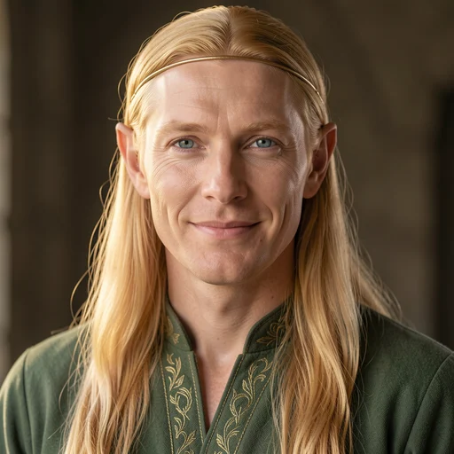 | Nargothrond, antes da missão com Beren | Filho de Finarfin e Eärwen. Rosto e cabelo dourado semelhantes aos do pai. [Fonte](https://tolkiengateway.net/wiki/Finrod) |
| Orodreth | 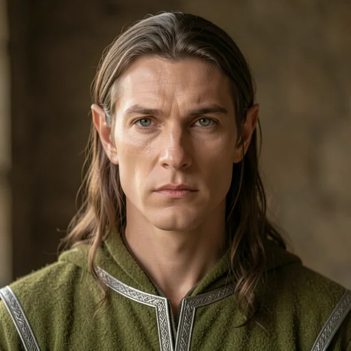 | Nargothrond, durante seu reinado | O catálogo segue O Silmarillion publicado: filho de Finarfin e Eärwen, irmão de Finrod e pai de Finduilas. [Fonte](https://tolkiengateway.net/wiki/Orodreth) |
| Finduilas de Nargothrond | 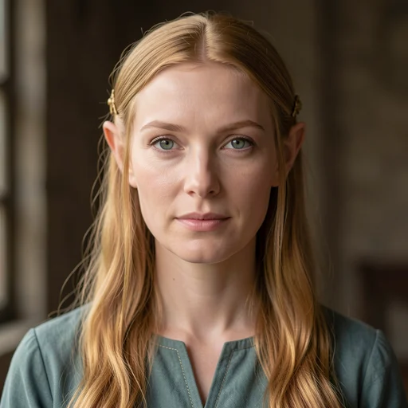 | Nargothrond, antes do saque | Filha de Orodreth; é a princesa de Nargothrond, não Finduilas de Dol Amroth. Cabelo dourado registrado no índice consultado. [Fonte](https://tolkiengateway.net/wiki/Finduilas) |
| Angrod | 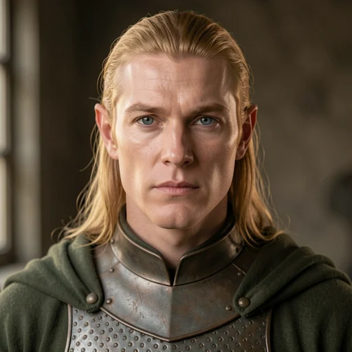 | Dorthonion, antes da Dagor Bragollach | Filho de Finarfin e Eärwen, senhor de Dorthonion com Aegnor. Cabelo dourado e mãos de grande força. [Fonte](https://tolkiengateway.net/wiki/Angrod) |
| Aegnor | 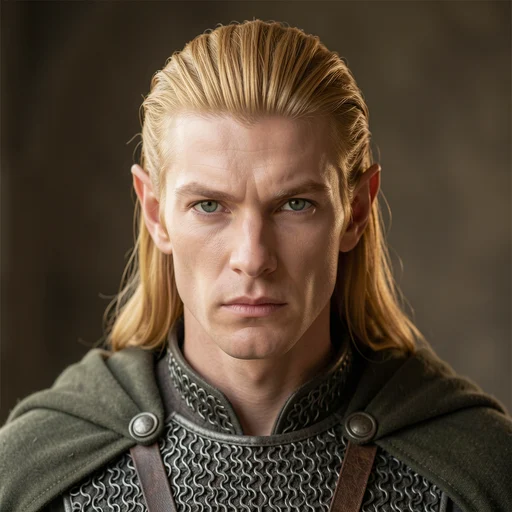 | Dorthonion, antes da Dagor Bragollach | Filho de Finarfin e Eärwen, irmão de Angrod. Cabelo dourado rígido e ereto; olhar descrito como ardente. [Fonte](https://tolkiengateway.net/wiki/Aegnor) |
| Glorfindel | 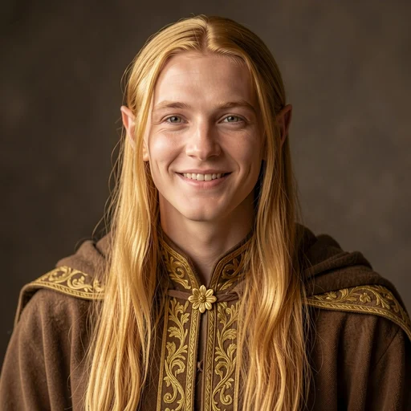 | Gondolin, antes da queda; identidade facial inspirada na caracterização dos filmes | Senhor da Casa da Flor Dourada em Gondolin; o catálogo adota a continuidade com o elfo reencarnado de Imladris. Cabelo longo e dourado; rosto descrito como jovem, destemido e alegre. [Fonte](https://tolkiengateway.net/wiki/Glorfindel) |
| Ecthelion da Fonte | 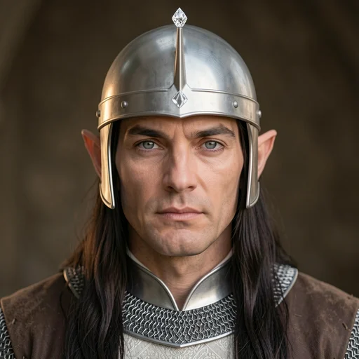 | Gondolin, guardião do Grande Portão | Senhor das Fontes e guardião do Grande Portão de Gondolin. Vestes prateadas e elmo com ponta de aço rematada por diamante. [Fonte](https://tolkiengateway.net/wiki/Ecthelion) |
| Voronwë | 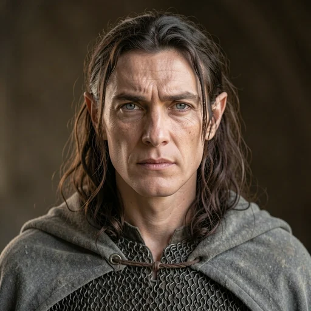 | Nevrast, após o naufrágio e antes da chegada a Gondolin | Marinheiro de Gondolin, filho de Aranwë e de uma Sinda aparentada a Círdan. Olhos cinzentos como o mar; cota élfica e grande manto. [Fonte](https://tolkiengateway.net/wiki/Voronw%C3%AB) |

## Pesquisa e variação familiar

A pesquisa usou páginas de Tolkien Gateway e suas remissões às obras; **não houve consulta direta a uma edição dos livros**. Cabelo, olhos, vestes e relações só são classificados como documentados quando encontrados no material consultado. Cores de olhos, feições e penteados adicionais aparecem como inferências em [data/retratos.json](../data/retratos.json).

Os parentes foram comparados durante o briefing e a revisão. O ensaio com referências faciais copiava demais as identidades; por isso, os 19 personagens sem intérprete correspondente confirmado receberam gerações por texto com traços próprios. O catálogo mantém semelhanças familiares, com diferenças de mandíbula, nariz, olhos, expressão e cabelo. Os [prompts finais e parâmetros](retratos-etapa-3-prompts.json) distinguem referências consultadas das imagens efetivamente enviadas à API.

- **Anairë:** nova ficha, ligada a Fingon, Turgon e Aredhel. A maternidade é complemento de *The Peoples of Middle-earth*, *The Shibboleth of Fëanor*, pp. 344–345, consultado por remissão. Ela e Elenwë não receberam um parentesco inventado com Indis só por compartilhar povo ou estilo.
- **Orodreth:** preservado como filho de Finarfin e Eärwen, conforme a genealogia do *Silmarillion* publicado já usada no projeto. A versão tardia que o faz filho de Angrod está anotada. Seu cabelo loiro-acinzentado é inferido, sem cor individual localizada nas fontes consultadas. Um ajuste local retirou a barba por fazer que apareceu no primeiro resultado.
- **Aegnor:** cabelo dourado rígido e ereto, mantendo o ardor na expressão, sem fogo literal nos olhos. **Maeglin:** cabelo negro, olhos escuros e feições que remetem à família materna.
- **Ecthelion:** elmo prateado aberto, com ponta rematada por diamante, e rosto visível. **Voronwë:** olhos cinzentos como o mar; o cabelo e o aspecto de marinheiro são artísticos. Seus pais são citados na ficha, sem criar vínculos com pessoas diferentes só para preencher a árvore.

## Glorfindel e a referência cinematográfica

Foi usada a caracterização élfica de **Jarl Benzon**, identificado como Glorfindel em [divulgação de evento com o elenco](https://www.theonering.net/torwp/2004/08/07/24636-ala-lee-to-attend-fellowship-festival/) e na [fotografia autografada consultada](https://www.tolkienwinkel.nl/contents/nl/p11448.html). A associação pertence a material de cartas e divulgação: o personagem não é identificado pelo nome em diálogo no filme. Não confundir com Sandro Kopp, associado a Gildor no mesmo registro do elenco.

O cabelo ficou dourado conforme a descrição de Tolkien, embora a fotografia consultada mostre tom mais escuro. O traje e a época do retrato são de Gondolin; a imagem não pretende reproduzir uma cena filmada da Primeira Era. A continuidade com o Glorfindel reencarnado de Imladris segue a identificação dos escritos tardios, registrada na ficha.

## Gandalf concluído

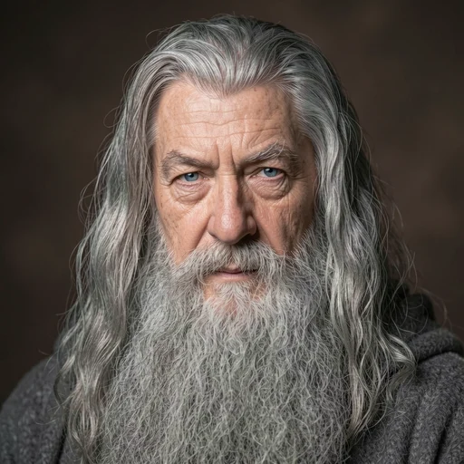

A API local produziu o retrato de Ian McKellen como Gandalf, o Cinzento. A imagem foi inspecionada e integrada pelo mesmo ID existente; as recusas anteriores das ferramentas GPT continuam registradas como histórico da [etapa 2](RETRATOS-ETAPA-2.md). A etapa 2 agora tem **24/24 retratos integrados**.

## Integração e verificação

Reutilizados o cadastro, o carregamento por ID e os componentes existentes de ficha, cartão e árvore em tela cheia. Foram acrescentadas quatro fichas: Anairë, Glorfindel, Ecthelion e Voronwë. Não foram adicionadas dependências ou um gerador à aplicação. Os originais e metadados ficam em `output/imagegen/etapa3/`, ignorados pelo Git; a aplicação usa os WebP versionados em `public/retratos/`.

- Build completo: **152 testes aprovados**, validação de dados, TypeScript e empacotamento de produção.
- **58 WebP** decodificados, com 512 × 512 px; todos carregaram com HTTP 200, tipo image/webp e bytes idênticos ao arquivo local.
- **21 novos arquivos**, somando **648.374 bytes**; o maior tem **54.294 bytes**, abaixo de 100 KiB. Os originais selecionados têm 1024 × 1024 px.
- Os **37 retratos anteriores** mantiveram os mesmos metadados e hashes SHA-256.
- Miniaturas circulares de 96 px e 36 px inspecionadas lado a lado, incluindo os pais já criados. Os testes cobrem as imagens na ficha, nos cartões e no cabeçalho da árvore em tela cheia.
- A automação do Chrome continua falhando ao ler o DOM da aba aberta (`timeoutMs`); a conferência visual da página em computador e celular permanece pendente.
- Não executei commit, push ou publicação na VPS nesta entrega; o trabalho foi feito no projeto local compartilhado.
