# Retratos — etapas 4 a 8 e revisão pelos atores

Entrega de **7 de novembro de 2026**. As etapas 4 a 8 completam o catálogo de **150 retratos** do roadmap. A geração usou a **API local ComfyUI (FLUX.2 Klein 9B)** do servidor 10.1.4.150, com o mesmo cliente do HopeGym; a OpenAI não foi necessária. Cada personagem recebeu três variações, revisadas em folhas de contato; a aprovada virou WebP de 512 × 512 com menos de 100 KiB.

Os prompts e as notas de pesquisa de cada etapa estão em `docs/retratos-etapa-N-prompts.json`; as decisões por personagem (documentado, inferido, fontes) estão em [data/retratos.json](../data/retratos.json).

## Etapa 4 — Doriath e os Grandes Contos

| Personagem | Retrato | Época | Base documentada | Fonte |
| --- | --- | --- | --- | --- |
| Elu Thingol | 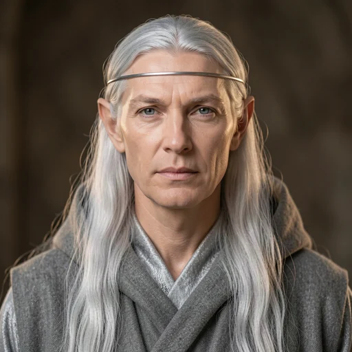 | Menegroth, no auge de Doriath | O mais alto dos Filhos de Ilúvatar; cabelo prateado. Chamado Singollo, Manto-gris. | O Silmarillion, Quenta, caps. 4 e 10. Consulta por conhecimento prévio da obra. |
| Melian | 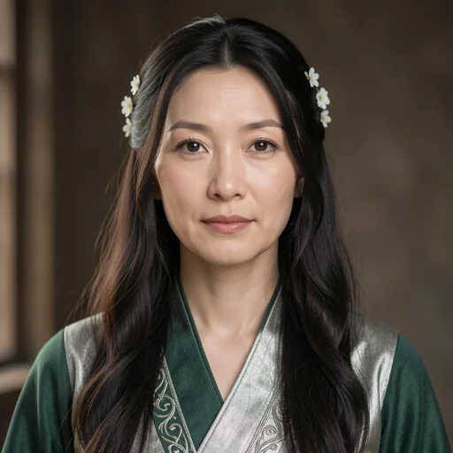 | Doriath, rainha ao lado de Thingol | Maia do séquito de Yavanna e Vána, de grande beleza e sabedoria; cantora. | O Silmarillion, Valaquenta; Quenta, cap. 4. Consulta por conhecimento prévio da obra. |
| Lúthien Tinúviel | 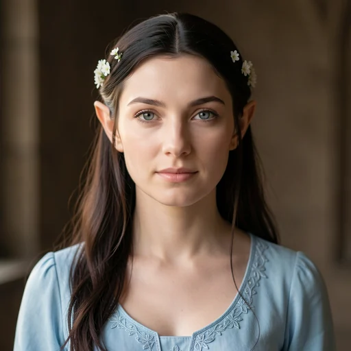 | Doriath, antes da demanda da Silmaril | Cabelo escuro como as sombras do crepúsculo e olhos cinzentos como a noite estrelada. Vestes azuis como o céu sem nuvens; flores nos cabelos. | O Silmarillion, Quenta, cap. 19. Consulta por conhecimento prévio da obra. |
| Beren Erchamion | 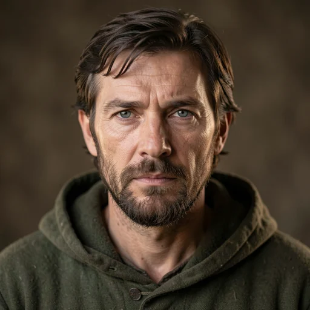 | Doriath, depois do encontro com Lúthien | Homem da Casa de Bëor, filho de Barahir; viveu anos como fora da lei em Dorthonion. | O Silmarillion, Quenta, cap. 19. Consulta por conhecimento prévio da obra. |
| Barahir | 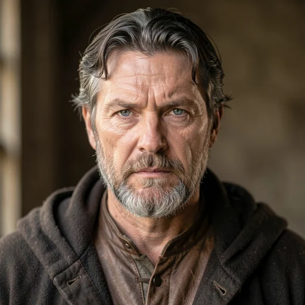 | Dorthonion, depois da Dagor Bragollach | Senhor da Casa de Bëor; resistiu como fora da lei em Dorthonion depois da Bragollach. | O Silmarillion, Quenta, cap. 18. Consulta por conhecimento prévio da obra. |
| Dior Eluchíl | 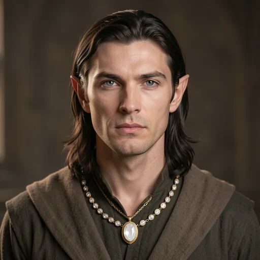 | Menegroth, rei de Doriath | Filho de Beren e Lúthien, entre os mais belos do mundo. Usava o Nauglamír com a Silmaril. | O Silmarillion, Quenta, cap. 22. Consulta por conhecimento prévio da obra. |
| Nimloth | 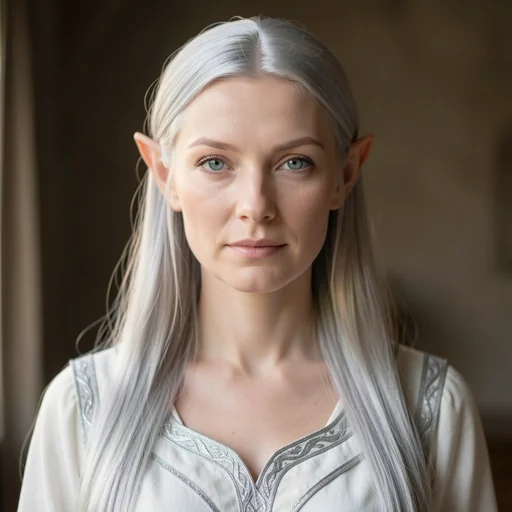 | Menegroth, rainha de Dior | Elfa de Doriath, parente de Celeborn; esposa de Dior. | O Silmarillion, Quenta, cap. 22. Consulta por conhecimento prévio da obra. |
| Elwing | 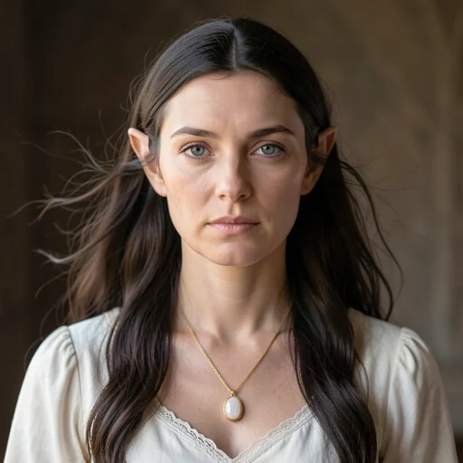 | Portos do Sirion | Elwing, a Branca; guardou a Silmaril no Nauglamír nos Portos do Sirion. | O Silmarillion, Quenta, cap. 24. Consulta por conhecimento prévio da obra. |
| Eärendil | 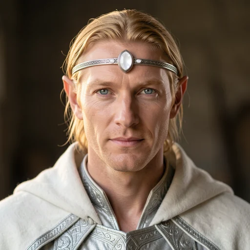 | A viagem a Valinor | Navegou até Valinor com a Silmaril presa à fronte. | O Silmarillion, Quenta, cap. 24. Consulta por conhecimento prévio da obra. |
| Elros Tar-Minyatur | 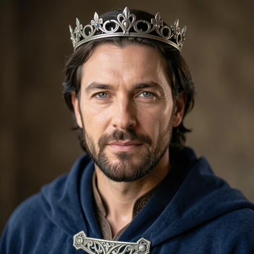 | Primeiro Rei de Númenor | Irmão de Elrond, escolheu o destino dos Homens e foi o primeiro Rei de Númenor. | Contos Inacabados, Parte II, cap. 3. Consulta por conhecimento prévio da obra. |
| Húrin Thalion | 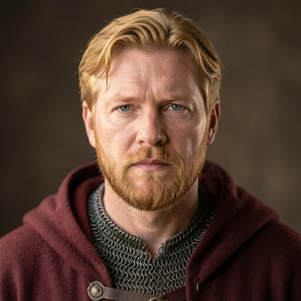 | Dor-lómin, antes da Nirnaeth Arnoediad | Senhor de Dor-lómin, da Casa de Hador, de cabelo dourado; menos alto que seus pais, mas incansável. | O Silmarillion, Quenta, caps. 18 e 20. Consulta por conhecimento prévio da obra. |
| Morwen Eledhwen | 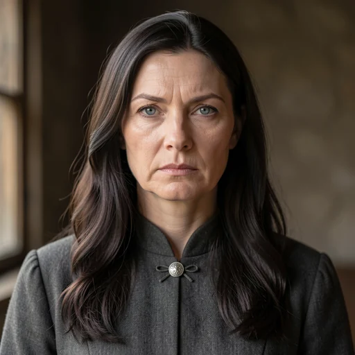 | Dor-lómin, antes da Nirnaeth Arnoediad | Chamada Eledhwen, de beleza élfica; cabelo escuro, olhos cinzentos, orgulhosa e severa. | O Silmarillion, Quenta, cap. 21. Consulta por conhecimento prévio da obra. |
| Túrin Turambar | 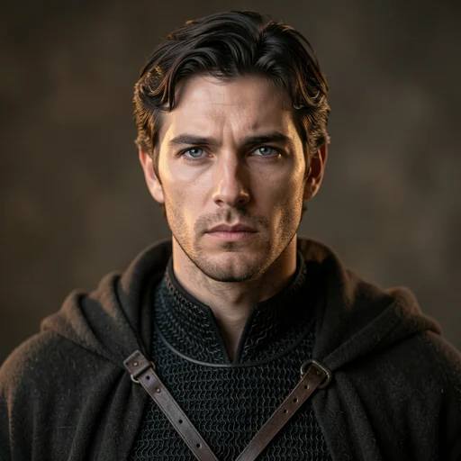 | Nargothrond, como Mormegil | Filho de Húrin e Morwen; alto, de cabelo escuro e olhos cinzentos como a mãe. | O Silmarillion, Quenta, cap. 21. Consulta por conhecimento prévio da obra. |
| Niënor Níniel | 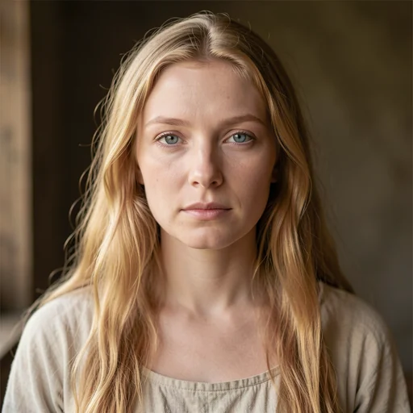 | Brethil, como Níniel | Filha de Húrin e Morwen; cabelo dourado como o do pai. | O Silmarillion, Quenta, cap. 21. Consulta por conhecimento prévio da obra. |
| Huor | 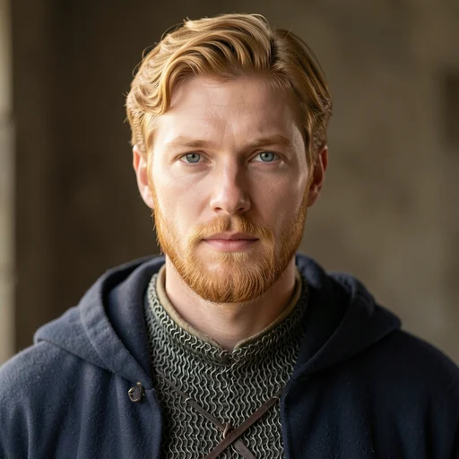 | Antes da Nirnaeth Arnoediad | Irmão de Húrin, da Casa de Hador, de cabelo dourado; viveu um tempo em Gondolin. | O Silmarillion, Quenta, caps. 18 e 20. Consulta por conhecimento prévio da obra. |
| Rían | 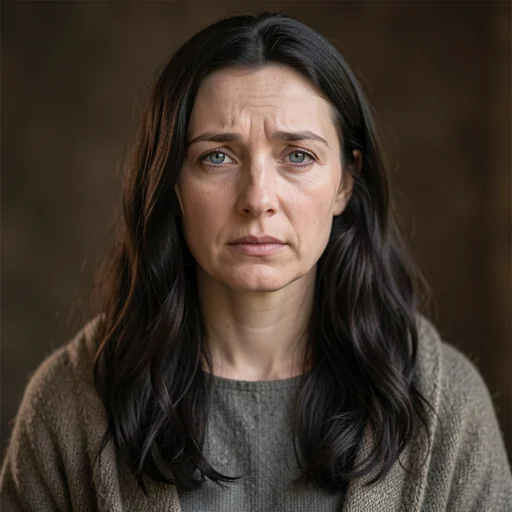 | Dor-lómin, esposa de Huor | Da Casa de Bëor, esposa de Huor e mãe de Tuor. | O Silmarillion, Quenta, cap. 20. Consulta por conhecimento prévio da obra. |
| Tuor | 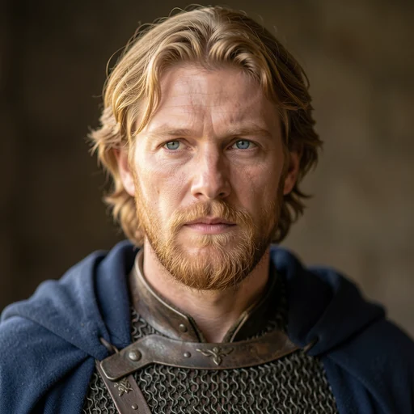 | Chegada a Gondolin | Filho de Huor, da Casa de Hador, de cabelo dourado; recebeu as armas deixadas por Turgon em Vinyamar. | Contos Inacabados, De Tuor e sua chegada a Gondolin. Consulta por conhecimento prévio da obra. |
| Beleg Cúthalion | 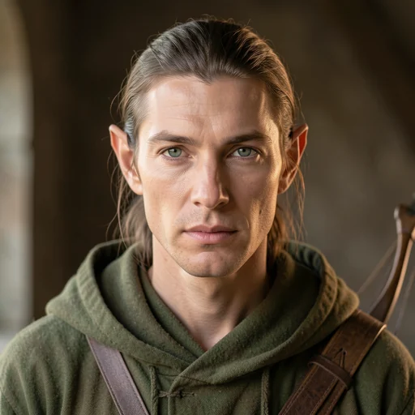 | Marcas de Doriath | Arco-forte, chefe dos guardas das fronteiras de Doriath e amigo de Túrin. | O Silmarillion, Quenta, cap. 21. Consulta por conhecimento prévio da obra. |
| Gwindor | 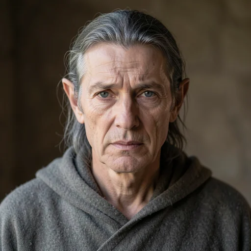 | Nargothrond, depois da fuga de Angband | Senhor de Nargothrond, filho de Guilin; voltou alquebrado e envelhecido depois de escapar de Angband. | O Silmarillion, Quenta, caps. 20 e 21. Consulta por conhecimento prévio da obra. |
| Haleth | 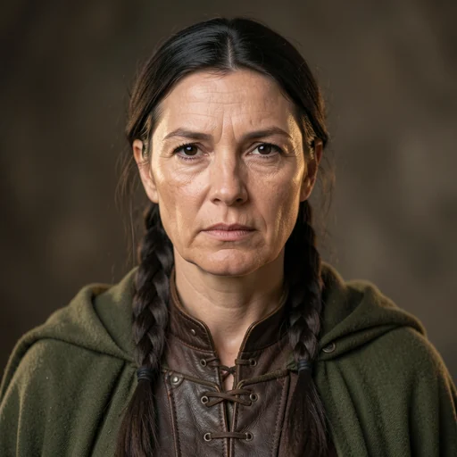 | Chefe dos Haladin | Senhora dos Haladin, de grande coragem; levou seu povo para Brethil. | O Silmarillion, Quenta, cap. 17. Consulta por conhecimento prévio da obra. |

## Etapa 5 — Segunda Era e herdeiros de Númenor

| Personagem | Retrato | Época | Base documentada | Fonte |
| --- | --- | --- | --- | --- |
| Gil-galad | 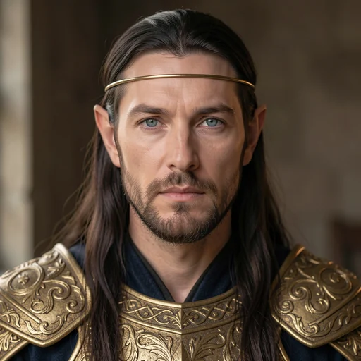 | Lindon, na Última Aliança | Último Alto Rei dos Noldor; liderou a Última Aliança com Elendil. | O Silmarillion, Dos Anéis de Poder. Consulta por conhecimento prévio da obra. |
| Círdan | 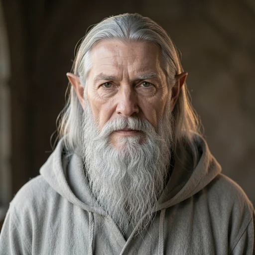 | Mithlond, no fim da Terceira Era | Muito alto, de barba longa, grisalho e com aparência de velho, salvo os olhos, agudos como estrelas. | O Senhor dos Anéis, O Retorno do Rei, Livro VI, cap. 9. Consulta por conhecimento prévio da obra. |
| Elendil | 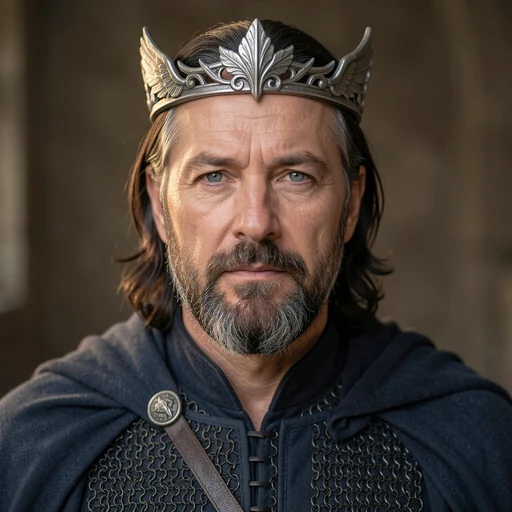 | Grande Rei de Arnor e Gondor | Chamado o Alto; fundou Arnor e Gondor depois da Queda de Númenor. | O Silmarillion, Akallabêth; Dos Anéis de Poder. Consulta por conhecimento prévio da obra. |
| Isildur | 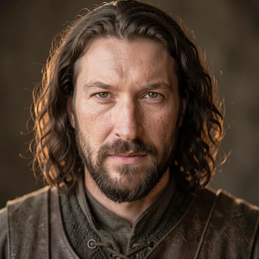 | Fim da Segunda Era | Filho mais velho de Elendil; cortou o Um Anel da mão de Sauron. | O Silmarillion, Dos Anéis de Poder. Consulta por conhecimento prévio da obra. |
| Anárion | 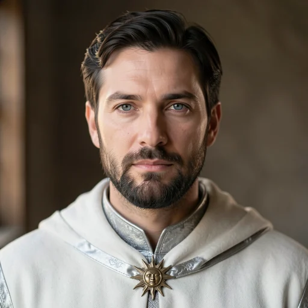 | Gondor, fim da Segunda Era | Filho mais novo de Elendil; governou Gondor com Isildur a partir de Osgiliath. | O Senhor dos Anéis, Apêndice A, I (iv). Consulta por conhecimento prévio da obra. |
| Ar-Pharazôn | 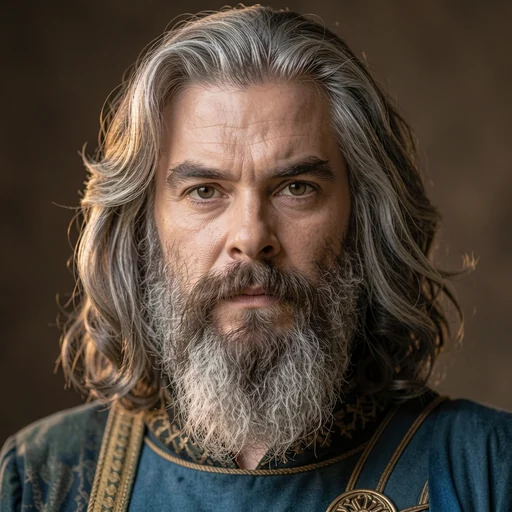 | Armenelos, antes da Queda | O Dourado, o mais poderoso e orgulhoso dos Reis de Númenor. | O Silmarillion, Akallabêth. Consulta por conhecimento prévio da obra. |
| Amandil | 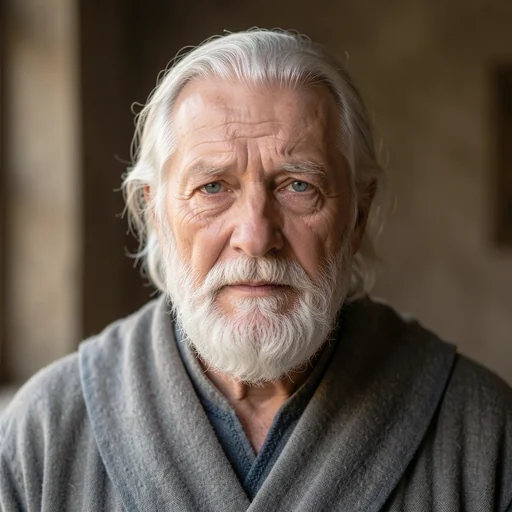 | Andúnië, antes da partida para o Oeste | Senhor de Andúnië e líder dos Fiéis; pai de Elendil. | O Silmarillion, Akallabêth. Consulta por conhecimento prévio da obra. |
| Meneldil | 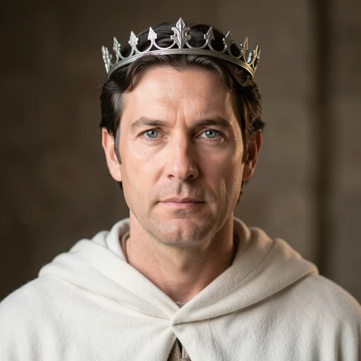 | Rei de Gondor | Filho de Anárion; recebeu de Isildur o governo de Gondor. | O Senhor dos Anéis, Apêndice A, I (iv). Consulta por conhecimento prévio da obra. |
| Valandil | 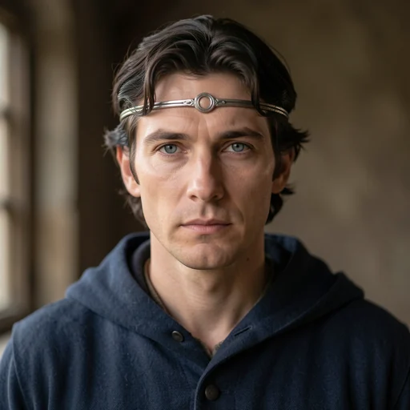 | Rei de Arnor | Filho caçula de Isildur, criado em Imladris; Rei de Arnor. | O Senhor dos Anéis, Apêndice A, I (iii). Consulta por conhecimento prévio da obra. |
| Arathorn II | 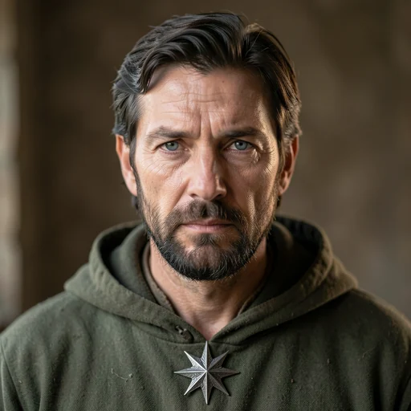 | Chefe dos Dúnedain | Chefe dos Dúnedain do Norte e pai de Aragorn. | O Senhor dos Anéis, Apêndice A, I (v). Consulta por conhecimento prévio da obra. |
| Gilraen | 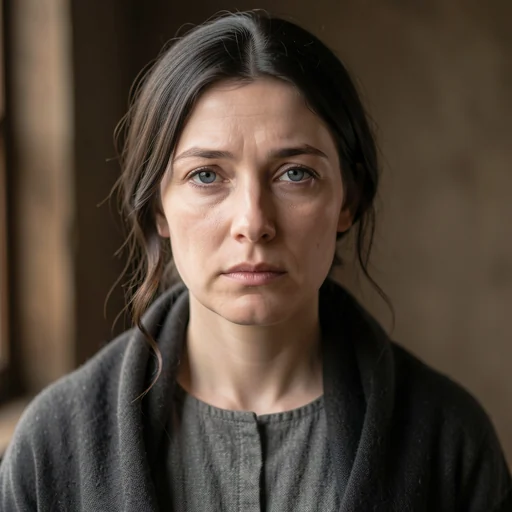 | Imladris, mãe de Aragorn | Gilraen, a Bela; criou Aragorn em Imladris. | O Senhor dos Anéis, Apêndice A, I (v). Consulta por conhecimento prévio da obra. |
| Celebrían | 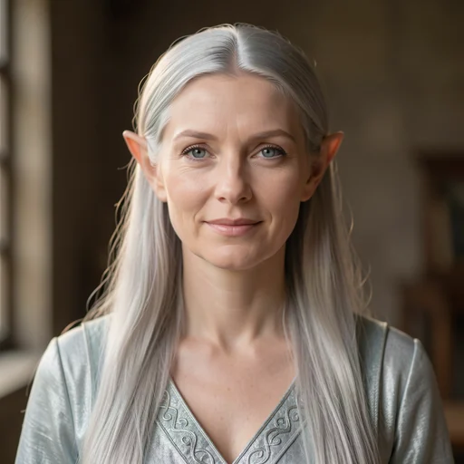 | Imladris, antes da partida | Filha de Celeborn e Galadriel; esposa de Elrond. | O Senhor dos Anéis, Apêndice A, I (v). Consulta por conhecimento prévio da obra. |
| Elladan | 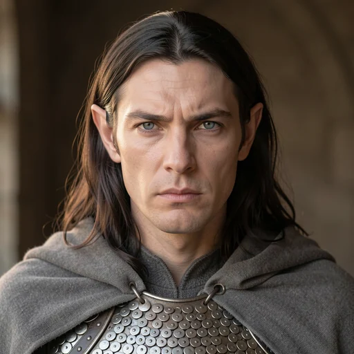 | Guerra do Anel | Gêmeo de Elrohir, tão parecidos que não se distinguiam; cavalgou com os Dúnedain. | O Senhor dos Anéis, O Retorno do Rei, Livro V, cap. 2. Consulta por conhecimento prévio da obra. |
| Elrohir | 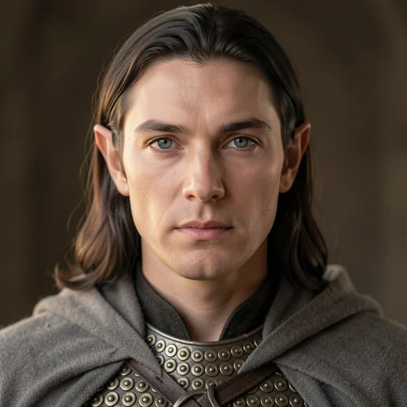 | Guerra do Anel | Gêmeo de Elladan, tão parecidos que não se distinguiam. | O Senhor dos Anéis, O Retorno do Rei, Livro V, cap. 2. Consulta por conhecimento prévio da obra. |
| Eldarion | 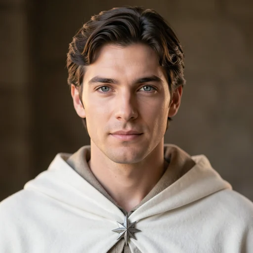 | Quarta Era, príncipe herdeiro | Filho de Aragorn e Arwen; herdou o Reino Reunido. | O Senhor dos Anéis, Apêndice A, I (v). Consulta por conhecimento prévio da obra. |
| Tar-Aldarion | 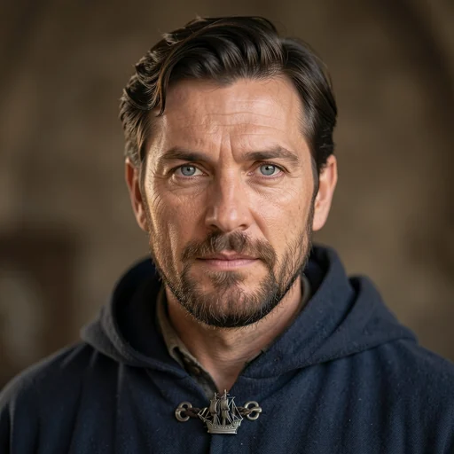 | Rei Navegador de Númenor | Rei de Númenor, grande navegador; fundou a Guilda dos Aventureiros. | Contos Inacabados, Parte II, cap. 2. Consulta por conhecimento prévio da obra. |
| Erendis | 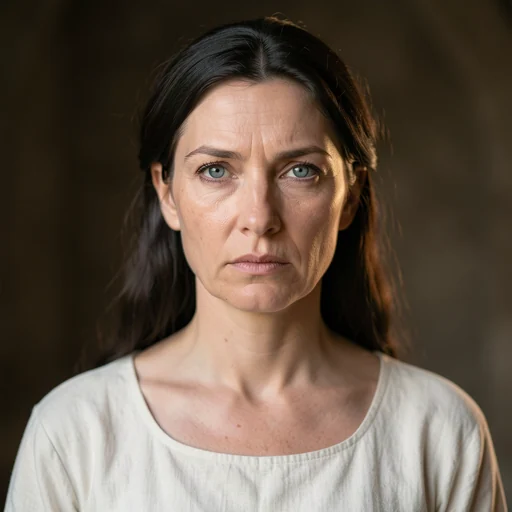 | Númenor, esposa de Aldarion | Esposa de Aldarion, que se afastou dele pelas longas viagens; mãe de Tar-Ancalimë. | Contos Inacabados, Parte II, cap. 2. Consulta por conhecimento prévio da obra. |
| Tar-Ancalimë | 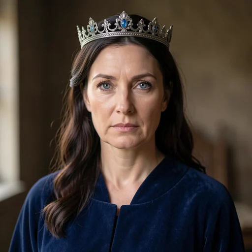 | Primeira Rainha Regente de Númenor | Filha de Aldarion e Erendis, primeira Rainha Regente de Númenor. | Contos Inacabados, Parte II, cap. 2. Consulta por conhecimento prévio da obra. |
| Tar-Míriel | 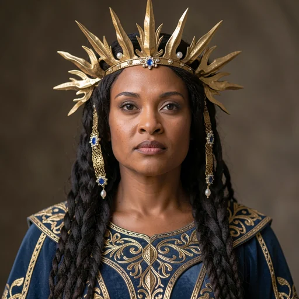 | Antes da usurpação de Ar-Pharazôn | Herdeira legítima do cetro, forçada a casar com Ar-Pharazôn. | O Silmarillion, Akallabêth. Consulta por conhecimento prévio da obra. |

## Etapa 6 — O Hobbit e a linhagem de Durin

| Personagem | Retrato | Época | Base documentada | Fonte |
| --- | --- | --- | --- | --- |
| Thorin Escudo de Carvalho | 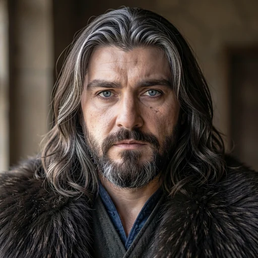 | A jornada a Erebor, 2941 T.E. | Capuz azul-celeste com uma longa borla de prata; o mais importante dos anões da companhia. | O Hobbit, cap. 1. Consulta por conhecimento prévio da obra. |
| Balin | 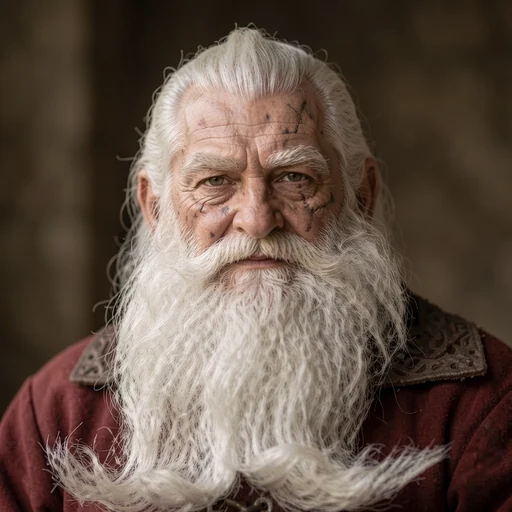 | A jornada a Erebor, 2941 T.E. | Capuz escarlate; parece mais velho que os outros e é bondoso com Bilbo. | O Hobbit, cap. 1. Consulta por conhecimento prévio da obra. |
| Dwalin | 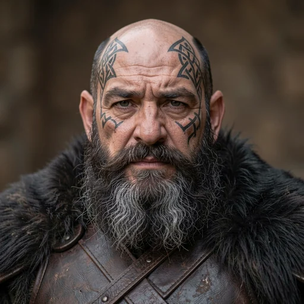 | A jornada a Erebor, 2941 T.E. | Capuz verde-escuro e barba azul presa num cinto dourado. | O Hobbit, cap. 1. Consulta por conhecimento prévio da obra. |
| Fíli | 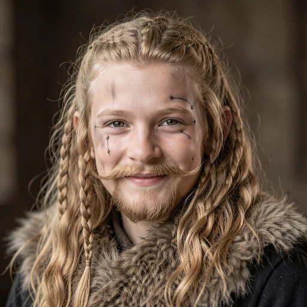 | A jornada a Erebor, 2941 T.E. | Capuz azul, cinto de prata e barba amarela; um dos mais jovens, sobrinho de Thorin. | O Hobbit, cap. 1. Consulta por conhecimento prévio da obra. |
| Kíli | 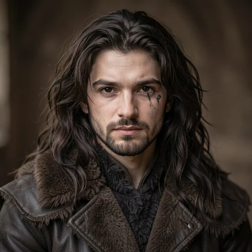 | A jornada a Erebor, 2941 T.E. | Capuz azul, cinto de prata e barba amarela; irmão de Fíli e sobrinho de Thorin. | O Hobbit, cap. 1. Consulta por conhecimento prévio da obra. |
| Glóin | 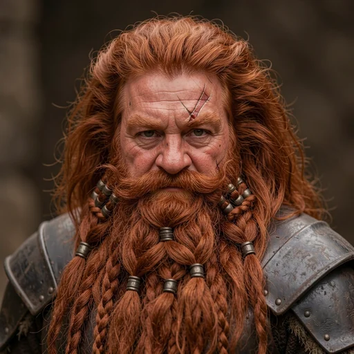 | A jornada a Erebor, 2941 T.E. | Capuz branco; irmão de Óin e pai de Gimli. | O Hobbit, cap. 1. Consulta por conhecimento prévio da obra. |
| Óin | 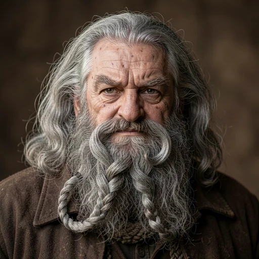 | A jornada a Erebor, 2941 T.E. | Capuz castanho; irmão de Glóin. | O Hobbit, cap. 1. Consulta por conhecimento prévio da obra. |
| Dori | 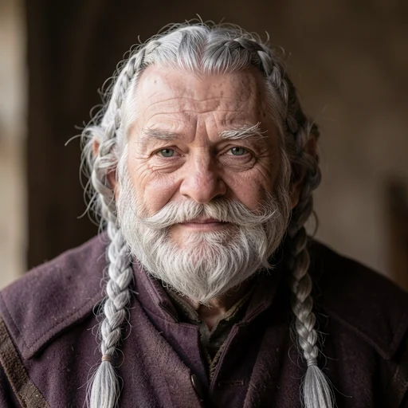 | A jornada a Erebor, 2941 T.E. | Capuz roxo; o mais forte da companhia, segundo o narrador. | O Hobbit, cap. 1. Consulta por conhecimento prévio da obra. |
| Nori | 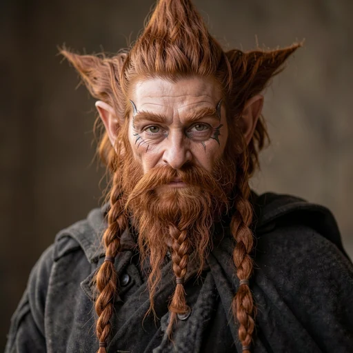 | A jornada a Erebor, 2941 T.E. | Capuz roxo; irmão de Dori e Ori. | O Hobbit, cap. 1. Consulta por conhecimento prévio da obra. |
| Ori | 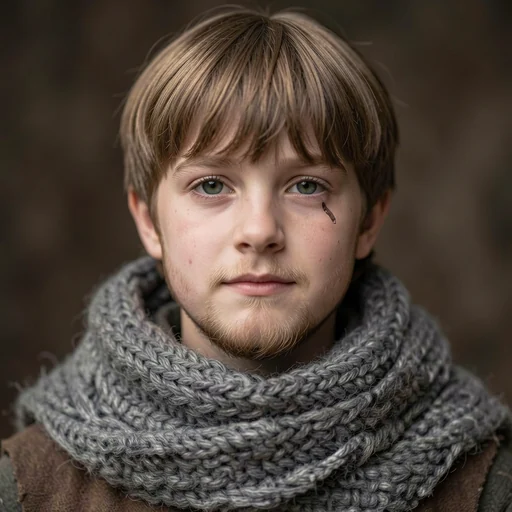 | A jornada a Erebor, 2941 T.E. | Capuz cinzento; irmão de Dori e Nori. | O Hobbit, cap. 1. Consulta por conhecimento prévio da obra. |
| Bifur | 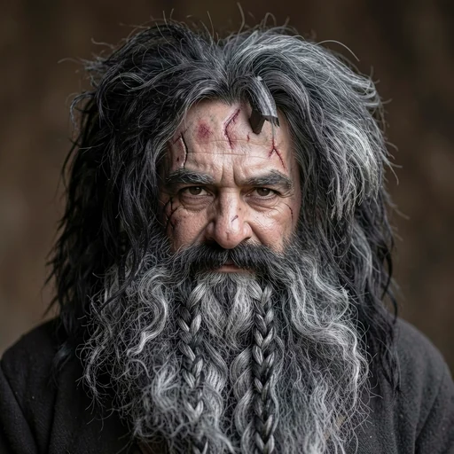 | A jornada a Erebor, 2941 T.E. | Capuz amarelo. | O Hobbit, cap. 1. Consulta por conhecimento prévio da obra. |
| Bofur |  | A jornada a Erebor, 2941 T.E. | Capuz amarelo; irmão de Bombur. | O Hobbit, cap. 1. Consulta por conhecimento prévio da obra. |
| Bombur |  | A jornada a Erebor, 2941 T.E. | Capuz verde-claro; muito gordo. | O Hobbit, cap. 1. Consulta por conhecimento prévio da obra. |
| Dáin II Pé de Ferro |  | Batalha dos Cinco Exércitos, 2941 T.E. | Senhor das Colinas de Ferro, primo de Thorin; tornou-se Rei sob a Montanha. | O Hobbit, cap. 17. Consulta por conhecimento prévio da obra. |
| Bard |  | Esgaroth, 2941 T.E. | Bard, de voz e rosto sombrios; descendente de Girion de Valle; matou Smaug com a Flecha Negra. | O Hobbit, cap. 14. Consulta por conhecimento prévio da obra. |
| Thranduil |  | Salões do Rei Elfo, outono de 2941 T.E. | Cabelo dourado e coroa de frutos silvestres e folhas vermelhas no outono. | O Hobbit, cap. 8. Consulta por conhecimento prévio da obra. |
| Beorn |  | Casa de Beorn, 2941 T.E. | Homem enorme, de barba e cabelo negros e espessos, braços nus musculosos e túnica de lã. | O Hobbit, cap. 7. Consulta por conhecimento prévio da obra. |
| Durin, o Imortal |  | Khazad-dûm, nos Dias Antigos | O mais velho dos Sete Pais dos Anões; fundou Khazad-dûm. | O Senhor dos Anéis, Apêndice A, III O Povo de Durin. Consulta por conhecimento prévio da obra. |
| Thrór |  | Rei sob a Montanha, antes de Smaug | Rei sob a Montanha; perdeu Erebor para Smaug e foi morto por Azog em Moria. | O Senhor dos Anéis, Apêndice A, III O Povo de Durin. Consulta por conhecimento prévio da obra. |
| Thráin II |  | Depois de Azanulbizar | Perdeu um olho na Batalha de Azanulbizar; pai de Thorin. | O Senhor dos Anéis, Apêndice A, III O Povo de Durin. Consulta por conhecimento prévio da obra. |
| Azog |  | Moria, antes de Azanulbizar | Grande Orc de Moria; matou Thrór e foi morto por Dáin em Azanulbizar. | O Senhor dos Anéis, Apêndice A, III O Povo de Durin. Consulta por conhecimento prévio da obra. |
| Bolg |  | Batalha dos Cinco Exércitos, 2941 T.E. | Filho de Azog; liderou os Orcs na Batalha dos Cinco Exércitos e foi morto por Beorn. | O Hobbit, cap. 17. Consulta por conhecimento prévio da obra. |

## Etapa 7 — Valar e outras figuras de Aman e da Terra-média

| Personagem | Retrato | Época | Base documentada | Fonte |
| --- | --- | --- | --- | --- |
| Manwë |  | Valinor, nos Anos das Árvores | Rei Antigo de Arda, senhor dos ventos e do ar; habita Ilmarin, no Taniquetil. | O Silmarillion, Valaquenta. Consulta por conhecimento prévio da obra. |
| Varda |  | Valinor, nos Anos das Árvores | Rainha das Estrelas, esposa de Manwë; a luz de Ilúvatar ainda vive em seu rosto. | O Silmarillion, Valaquenta. Consulta por conhecimento prévio da obra. |
| Ulmo |  | Valinor, nos Anos das Árvores | Senhor das Águas; apareceu a Tuor com elmo como uma onda e cota de malha prateada e verde-escura. | O Silmarillion, Valaquenta; Contos Inacabados, De Tuor e sua chegada a Gondolin. Consulta por conhecimento prévio da obra. |
| Aulë |  | Valinor, nos Anos das Árvores | O Ferreiro, senhor das substâncias da terra; criou os Anões. | O Silmarillion, Valaquenta. Consulta por conhecimento prévio da obra. |
| Yavanna |  | Valinor, nos Anos das Árvores | A Doadora de Frutos, esposa de Aulë; em forma de mulher, alta e vestida de verde. | O Silmarillion, Valaquenta. Consulta por conhecimento prévio da obra. |
| Mandos |  | Valinor, nos Anos das Árvores | Námo, o Juiz dos Valar e guardião das Casas dos Mortos. | O Silmarillion, Valaquenta. Consulta por conhecimento prévio da obra. |
| Vairë |  | Valinor, nos Anos das Árvores | A Tecelã, que tece as histórias do tempo em tapeçarias nas Casas de Mandos. | O Silmarillion, Valaquenta. Consulta por conhecimento prévio da obra. |
| Irmo |  | Valinor, nos Anos das Árvores | Senhor das visões e dos sonhos, dos jardins de Lórien. | O Silmarillion, Valaquenta. Consulta por conhecimento prévio da obra. |
| Estë |  | Valinor, nos Anos das Árvores | A Gentil, curadora das dores e do cansaço; veste cinza. | O Silmarillion, Valaquenta. Consulta por conhecimento prévio da obra. |
| Nienna |  | Valinor, nos Anos das Árvores | Senhora da piedade e do luto, que chora pelas feridas de Arda. | O Silmarillion, Valaquenta. Consulta por conhecimento prévio da obra. |
| Oromë |  | Valinor, nos Anos das Árvores | O Grande Cavaleiro, caçador; tocava a trompa Valaróma. | O Silmarillion, Valaquenta. Consulta por conhecimento prévio da obra. |
| Vána |  | Valinor, nos Anos das Árvores | A Sempre-jovem; as flores se abrem quando ela passa. | O Silmarillion, Valaquenta. Consulta por conhecimento prévio da obra. |
| Tulkas |  | Valinor, nos Anos das Árvores | O mais forte dos Valar; cabelo e barba dourados, pele corada; ri mesmo em combate. | O Silmarillion, Valaquenta. Consulta por conhecimento prévio da obra. |
| Nessa |  | Valinor, nos Anos das Árvores | Veloz como uma flecha; ama os cervos e a dança. | O Silmarillion, Valaquenta. Consulta por conhecimento prévio da obra. |
| Morgoth |  | Angband, Primeira Era | Melkor, o Inimigo; usava uma coroa de ferro com as três Silmarils, que lhe queimavam as mãos. | O Silmarillion, Valaquenta. Consulta por conhecimento prévio da obra. |
| Eönwë |  | A Guerra da Ira, Primeira Era | Arauto de Manwë, comandou a hoste dos Valar na Guerra da Ira. | O Silmarillion, Valaquenta. Consulta por conhecimento prévio da obra. |
| Ossë |  | Valinor, nos Anos das Árvores | Maia das ondas e das costas, vassalo de Ulmo; amigo dos Teleri. | O Silmarillion, Valaquenta. Consulta por conhecimento prévio da obra. |
| Uinen |  | Valinor, nos Anos das Árvores | Senhora dos Mares, cujo cabelo se espalha por todas as águas. | O Silmarillion, Valaquenta. Consulta por conhecimento prévio da obra. |
| Radagast |  | Rhosgobel, Terceira Era | Radagast, o Castanho, um dos Istari, mestre das formas e das cores e amigo das aves e dos animais. | O Senhor dos Anéis, A Sociedade do Anel, Livro II, cap. 2. Consulta por conhecimento prévio da obra. |
| Tom Bombadil |  | Floresta Velha, 3018 T.E. | Barba castanha longa, olhos azuis, rosto vermelho como maçã madura, chapéu surrado com pena azul e casaco azul. | O Senhor dos Anéis, A Sociedade do Anel, Livro I, cap. 6. Consulta por conhecimento prévio da obra. |
| Fruta d'Ouro |  | Casa de Tom Bombadil, 3018 T.E. | Cabelo dourado longo, vestido verde como juncos novos com brilho prateado de orvalho e cinto de ouro com flores azuis. | O Senhor dos Anéis, A Sociedade do Anel, Livro I, cap. 7. Consulta por conhecimento prévio da obra. |

## Etapa 8 — Completar os elos genealógicos

| Personagem | Retrato | Época | Base documentada | Fonte |
| --- | --- | --- | --- | --- |
| Elmo |  | Doriath, nos Anos das Árvores | Irmão mais novo de Thingol e de Olwë, avô de Celeborn. | Contos Inacabados, Parte II, cap. 4. Consulta por conhecimento prévio da obra. |
| Galadhon |  | Doriath | Filho de Elmo e pai de Celeborn e Galathil. | Contos Inacabados, Parte II, cap. 4. Consulta por conhecimento prévio da obra. |
| Galathil |  | Doriath | Irmão de Celeborn e pai de Nimloth. | Contos Inacabados, Parte II, cap. 4. Consulta por conhecimento prévio da obra. |
| Eluréd |  | Menegroth, pouco antes da ruína de Doriath | Filho de Dior, gêmeo de Elurín; ainda criança quando Doriath caiu. | O Silmarillion, Quenta, cap. 22. Consulta por conhecimento prévio da obra. |
| Elurín |  | Menegroth, pouco antes da ruína de Doriath | Filho de Dior, gêmeo de Eluréd; ainda criança quando Doriath caiu. | O Silmarillion, Quenta, cap. 22. Consulta por conhecimento prévio da obra. |
| Galdor |  | Dor-lómin, antes de 462 P.E. | Galdor, o Alto, senhor de Dor-lómin e pai de Húrin e Huor. | O Silmarillion, Quenta, cap. 18. Consulta por conhecimento prévio da obra. |
| Amdír |  | Lórinand, Segunda Era | Rei de Lórinand; caiu na Batalha de Dagorlad. | Contos Inacabados, Parte II, cap. 4. Consulta por conhecimento prévio da obra. |
| Amroth |  | Lórien, antes de partir em busca de Nimrodel | Rei de Lórien, apaixonado por Nimrodel; afogou-se na Baía de Belfalas. | Contos Inacabados, Parte II, cap. 4. Consulta por conhecimento prévio da obra. |
| Findis |  | Tirion, nos Anos das Árvores | Filha mais velha de Finwë e Indis; permaneceu em Aman. | The Peoples of Middle-earth, The Shibboleth of Fëanor. Consulta por conhecimento prévio da obra. |
| Írimë (Lalwen) |  | Tirion, antes do exílio | Filha de Finwë e Indis; seguiu o irmão Fingolfin para o exílio. | The Peoples of Middle-earth, The Shibboleth of Fëanor. Consulta por conhecimento prévio da obra. |

## Revisão dos rostos pelos atores

Regra adotada (também no AGENTS.md local): **os filmes de Peter Jackson têm prioridade**; a série *Os Anéis de Poder* é usada para personagens que só aparecem nela. **Exceção explícita do usuário:** Gil-galad segue Benjamin Walker (série), embora apareça brevemente no prólogo de *A Sociedade do Anel*.

As referências são fotos de cena e de divulgação baixadas de matérias jornalísticas, recortadas no rosto e enviadas ao ComfyUI como imagem de referência (ReferenceLatent). Ficam em `fontes-imagens/referencias/`, fora do Git; o registro de página e URL de origem está em `referencias.json` na mesma pasta. As versões anteriores, só por texto, foram preservadas em `fontes-imagens/retratos/<id>-texto/`.

| Personagem | Retrato | Ator | Obra | Página de origem da referência |
| --- | --- | --- | --- | --- |
| Balin |  | Ken Stott | The Hobbit: An Unexpected Journey (2012) | [www.slashfilm.com](https://www.slashfilm.com/beard-fetishists-rejoice-hobbit-dwarves-revealed-photo) |
| Dwalin |  | Graham McTavish | The Hobbit: An Unexpected Journey (2012) | [www.slashfilm.com](https://www.slashfilm.com/beard-fetishists-rejoice-hobbit-dwarves-revealed-photo) |
| Fíli |  | Dean O'Gorman | The Hobbit: An Unexpected Journey (2012) | [www.slashfilm.com](https://www.slashfilm.com/the-hobbit-photo-dwarves-fili-kili) |
| Kíli |  | Aidan Turner | The Hobbit: An Unexpected Journey (2012) | [www.slashfilm.com](https://www.slashfilm.com/the-hobbit-photo-dwarves-fili-kili) |
| Dori |  | Mark Hadlow | The Hobbit: An Unexpected Journey (2012) | [www.slashfilm.com](https://www.slashfilm.com/dwarves-dori-nori-ori-peter-jacksons-hobbit) |
| Nori |  | Jed Brophy | The Hobbit: An Unexpected Journey (2012) | [www.slashfilm.com](https://www.slashfilm.com/dwarves-dori-nori-ori-peter-jacksons-hobbit) |
| Ori |  | Adam Brown | The Hobbit: An Unexpected Journey (2012) | [www.slashfilm.com](https://www.slashfilm.com/dwarves-dori-nori-ori-peter-jacksons-hobbit) |
| Óin |  | John Callen | The Hobbit: An Unexpected Journey (2012) | [www.filmbuffonline.com](https://www.filmbuffonline.com/FBOLNewsreel/wordpress/2011/07/08/more-hobbit-dwarfs-this-time-oin-and-gloin/) |
| Glóin |  | Peter Hambleton | The Hobbit: An Unexpected Journey (2012) | [www.filmbuffonline.com](https://www.filmbuffonline.com/FBOLNewsreel/wordpress/2011/07/08/more-hobbit-dwarfs-this-time-oin-and-gloin/) |
| Bofur |  | James Nesbitt | The Hobbit: An Unexpected Journey (2012) | [www.slashfilm.com](https://www.slashfilm.com/photo-the-hobbit-bofur-bombur-bifur) |
| Bifur |  | William Kircher | The Hobbit: An Unexpected Journey (2012) | [www.slashfilm.com](https://www.slashfilm.com/photo-the-hobbit-bofur-bombur-bifur) |
| Thranduil |  | Lee Pace | The Hobbit: The Desolation of Smaug (2013) | [www.filmbuffonline.com](https://www.filmbuffonline.com/FBOLNewsreel/wordpress/2012/08/30/first-look-lee-pace-as-the-hobbits-thranduil/) |
| Celebrimbor |  | Charles Edwards | The Lord of the Rings: The Rings of Power (Amazon, 2022–2024) | [whattowatch.com](https://whattowatch.com/news/celebrimbor-wants-to-be-remembered-says-the-rings-of-power-star-charles-edwards) |
| Finrod Felagund |  | Will Fletcher | The Lord of the Rings: The Rings of Power (Amazon, 2022–2024) | [looper.com](https://looper.com/1281805/the-rings-of-power-who-plays-galadriels-brother-finrod) |
| Tar-Míriel |  | Cynthia Addai-Robinson | The Lord of the Rings: The Rings of Power (Amazon, 2022–2024) | [www.looper.com](https://www.looper.com/999624/why-queen-regent-miriel-from-the-lord-of-the-rings-the-rings-of-power-looks-so-familiar) |
| Ar-Pharazôn |  | Trystan Gravelle | The Lord of the Rings: The Rings of Power (Amazon, 2022–2024) | [geektyrant.com](https://geektyrant.com/news/new-photo-and-description-of-pharazn-of-nmenor-in-amazons-the-lord-of-the-rings-the-rings-of-power) |
| Gil-galad |  | Benjamin Walker | The Lord of the Rings: The Rings of Power (Amazon, 2022–2024) | [www.cheatsheet.com](https://www.cheatsheet.com/news/the-lord-of-the-rings-the-rings-of-power-star-benjamin-walker-looks-familiar.html) |
| Isildur |  | Harry Sinclair | The Lord of the Rings: The Fellowship of the Ring (2001) | [cultureslate.com](https://cultureslate.com/explained/who-is-isildur-everything-you-need-to-know-about-the-future-king) |
| Thorin |  | Richard Armitage | The Hobbit films by Peter Jackson (2012-2014) | [www.looper.com](https://www.looper.com/327796/heres-why-thorin-from-the-hobbit-looks-so-familiar) |
| Bard |  | Luke Evans | The Hobbit: The Desolation of Smaug (2013) | [movieweb.com](https://movieweb.com/luke-evans-talks-bard-the-bowman-in-the-hobbit-the-desolation-of-smaug-exclusive/) |

### Sem referência utilizável

Para estes personagens a busca não encontrou foto de cena em resolução útil, ou só achou imagens erradas (logotipos, outro personagem, ilustrações). Eles mantêm o retrato por descrição textual, com a pendência registrada na ficha:

- **Círdan**: Michael Elsworth, The Lord of the Rings: The Fellowship of the Ring (2001)
- **Elendil**: Peter McKenzie, The Lord of the Rings: The Fellowship of the Ring (2001)
- **Bombur**: Stephen Hunter, The Hobbit (2012–2014)
- **Dáin II Pé de Ferro**: Billy Connolly, The Hobbit (2012–2014)
- **Beorn**: Mikael Persbrandt, The Hobbit (2012–2014)
- **Thrór**: Jeffrey Thomas, The Hobbit (2012–2014)
- **Thráin II**: Michael Mizrahi, The Hobbit (2012–2014)
- **Azog**: Manu Bennett, The Hobbit (2012–2014)
- **Bolg**: John Tui, The Hobbit (2012–2014)
- **Radagast**: Sylvester McCoy, The Hobbit (2012–2014)

## Correções durante a revisão

- **Valar e Maiar:** o enquadramento inicial com a palavra “Ainu” foi lido pelo modelo como etnia; todos saíram com o mesmo traço e alguns com gênero trocado. Os 18 foram refeitos com “ser imortal na forma corporal de um homem/mulher adulto” e gênero explícito.
- **Valar e Maiar, aparência divina:** o usuário achou os rostos simplórios para deuses. Foram pesquisadas fan arts dos Valar no DeviantArt (cerca de 75 peças, lista em `docs/retratos-etapa-7-prompts.json`, campo `referencias_fan_art`) e extraídos os motivos recorrentes: beleza idealizada sem idade, luz própria e aura, cabelo ao vento sobrenatural, coroas luminosas e o elemento de cada Vala ao fundo (céu, estrelas, mar, forja, floresta); Morgoth com beleza sombria e as Silmarils iluminando o rosto. As fan arts serviram só para pesquisar motivos; nenhuma imagem de artista foi enviada ao modelo.
- **Dior, Galathil e Amroth** saíram femininos; **Thingol**, envelhecido. Refeitos com gênero explícito e pele sem rugas.
- **Retratos com referência:** o primeiro modelo de prompt (“preserve rosto, cabelo, barba e maquiagem”) produziu o mesmo rosto barbado para todos os anões e pôs barba em elfos e em Tar-Míriel. Cada um recebeu um prompt individual com a caracterização do filme ou da série.
- **Vinheta circular:** “margem para recorte circular” fazia o modelo desenhar um círculo; trocado por “quadro preenchido, sem vinheta”.
- O FLUX.2 Klein ignora prompt negativo; todas as correções foram escritas como instruções positivas.
