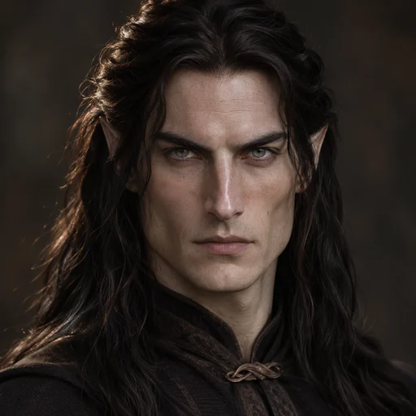
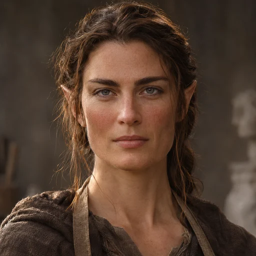
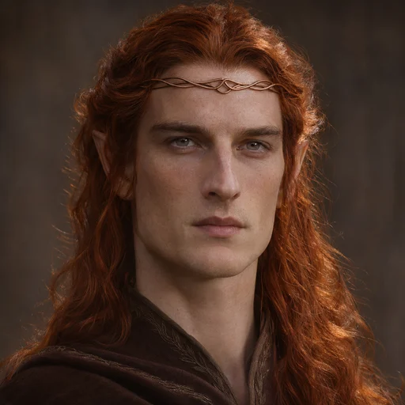
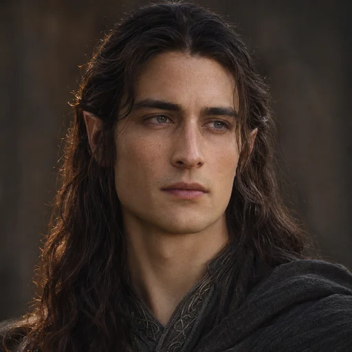
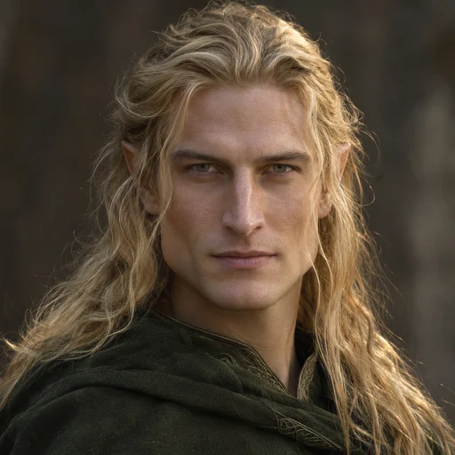
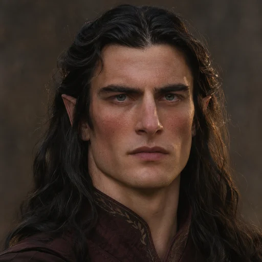
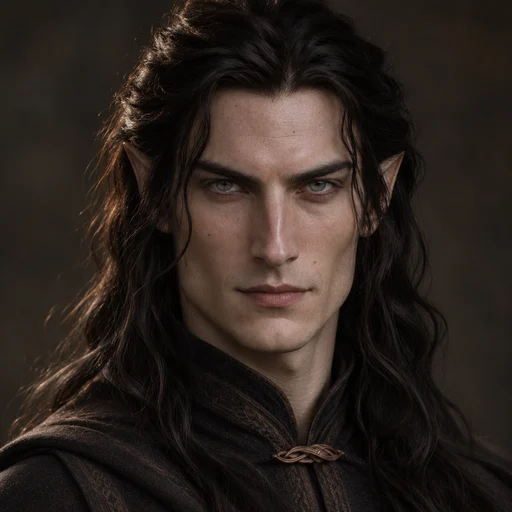
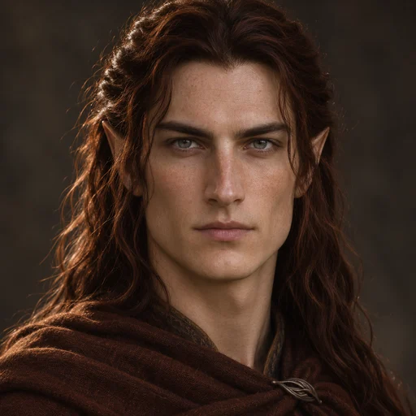
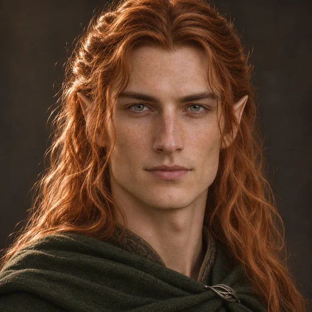

# Retratos da família de Fëanor

Nove retratos realistas gerados com a ferramenta image_gen integrada em 7 de novembro de 2026. Arquivos finais WebP de 512 × 512 em `public/retratos/feanor/`, aproximadamente 281 KiB no total. Nenhuma dependência foi adicionada.

O catálogo [data/retratos.json](../data/retratos.json) separa características documentadas, inferências por parentesco e notas de versões. As obras originais foram identificadas por referências do Tolkien Gateway; não houve consulta direta às edições impressas nesta tarefa. Cor dos olhos, anatomia precisa, idade aparente, roupas e iluminação são escolhas artísticas quando não especificadas nas fontes.

Os [prompts e referências visuais](retratos-feanor-prompts.json) ficam registrados para reproduzir ou continuar a série. Curufin e Amrod usaram os retratos dos pais como referência; Amras usou o retrato do irmão gêmeo.

## Galeria e pesquisa

| Personagem | Retrato | Base literária e escolhas |
| --- | --- | --- |
| Fëanor |  | Cabelos longos e escuros. Beleza e vigor excepcionais. Olhos cinzentos a partir da descrição geral dos Noldor. Geometria facial, idade aparente, roupa e expressão são interpretação artística. [The Nature of Middle-earth — Parte II, IV: Hair, p. 186](https://tolkiengateway.net/wiki/F%C3%ABanor); [O Silmarillion — Quenta Silmarillion, capítulos 6 e 11](https://tolkiengateway.net/wiki/F%C3%ABanor) |
| Nerdanel |  | Cabelo castanho e tez corada. Escultora de vontade firme e temperamento paciente. Olhos cinzentos pela linhagem Noldor. Traços do rosto e roupa de artesã são interpretação artística. [Vinyar Tengwar 41 — From The Shibboleth of Fëanor, p. 9](https://tolkiengateway.net/wiki/Nerdanel); [Morgoth’s Ring — The Later Quenta Silmarillion, p. 272](https://tolkiengateway.net/wiki/Nerdanel) |
| Maedhros |  | Cabelo ruivo acobreado herdado da linhagem de Mahtan. Porte alto e boa proporção corporal. Uso de um diadema de cobre. Olhos cinzentos pela linhagem Noldor. Feições combinando os dois pais; não foram acrescentadas cicatrizes sem descrição. [The Peoples of Middle-earth — The Shibboleth of Fëanor, pp. 352–353 e notas, p. 366](https://tolkiengateway.net/wiki/Maedhros) |
| Maglor |  | Cantor e músico; filho de Fëanor e Nerdanel. Cabelos escuros e olhos cinzentos derivados de Fëanor e da descrição geral dos Noldor; não foi localizada descrição individual dessas cores nas referências consultadas. Rosto com variações mais suaves das feições dos pais. [O Silmarillion — Of Eldamar and the Princes of the Eldalië](https://tolkiengateway.net/wiki/Maglor); [O Senhor dos Anéis — Apêndice F, On Translation (características gerais dos Noldor)](https://tolkiengateway.net/wiki/Noldor) |
| Celegorm |  | Caçador associado a Oromë. Cabelo longo dourado descrito na Quenta Silmarillion de 1937. Olhos cinzentos pela linhagem Noldor; rosto e roupa interpretativos. **Versão:** O retrato escolhe a versão antiga de cabelo dourado. Christopher Tolkien suprimiu esse detalhe no Silmarillion publicado; não deve ser apresentado como descrição inequívoca dessa edição. [The Lost Road and Other Writings — Quenta Silmarillion, comentários editoriais sobre Of Beren and Lúthien](https://tolkiengateway.net/wiki/Celegorm) |
| Caranthir |  | Cabelos negros como Finwë. Tez corada como a de Nerdanel. Olhos cinzentos pela linhagem Noldor. Feições variam a estrutura dos pais. [The Peoples of Middle-earth — The Shibboleth of Fëanor, The names of the Sons of Fëanor](https://tolkiengateway.net/wiki/Caranthir) |
| Curufin |  | Grande semelhança facial com Fëanor. Cabelos negros e olhos cinzentos seguindo o pai e a linhagem Noldor. Pequenas diferenças na expressão e na idade aparente distinguem o filho. [The Peoples of Middle-earth — The Shibboleth of Fëanor, The names of the Sons of Fëanor](https://tolkiengateway.net/wiki/Curufin) |
| Amrod |  | Um dos gêmeos ruivos, semelhantes em rosto. A descrição tardia diz que o cabelo do gêmeo mais velho escureceu. Aplicada a Amrod a tonalidade castanho-avermelhada mais escura, seguindo a ordem de nascimento predominante no Silmarillion publicado. Olhos cinzentos e estrutura facial derivados dos pais e dos Noldor. **Versão:** Textos tardios variam a ordem e o destino dos gêmeos; a aplicação dos tons aos nomes é uma escolha editorial, não uma certeza comum a todas as versões. [The Peoples of Middle-earth — The Shibboleth of Fëanor, pp. 352–355](https://tolkiengateway.net/wiki/Amrod) |
| Amras |  | Um dos gêmeos ruivos, semelhantes em rosto. Adotado ruivo acobreado mais claro que Amrod, segundo a mesma escolha editorial. Olhos cinzentos e traços familiares inferidos; o retrato de Amrod serviu como referência visual. **Versão:** A atribuição do tom mais claro a Amras acompanha a ordem predominante no Silmarillion publicado; versões tardias variam a ordem dos gêmeos. [The Peoples of Middle-earth — The Shibboleth of Fëanor, pp. 352–355](https://tolkiengateway.net/wiki/Amras) |

## Integração

Os retratos aparecem na árvore genealógica do atlas (botão *Linhagens*): em miniatura nos cartões da árvore e em tamanho maior no cabeçalho da ficha da pessoa, sempre marcados como "interpretação artística". A ligação é feita pelo `id`, que é o mesmo em `data/retratos.json` e `data/linhagens.json`. O `npm run validate` avisa quando um retrato não tem pessoa correspondente.

## Verificação dos arquivos

Todos os nove arquivos foram decodificados e conferidos em 512 × 512, com IDs únicos e referências locais existentes. A confirmação visual das imagens geradas verificou os cabelos, a distinção entre os irmãos e as semelhanças de Curufin e dos gêmeos. Não foi possível executar o build por indisponibilidade de criação de processos neste ambiente; não houve alteração em código executável, configuração ou dependências.
