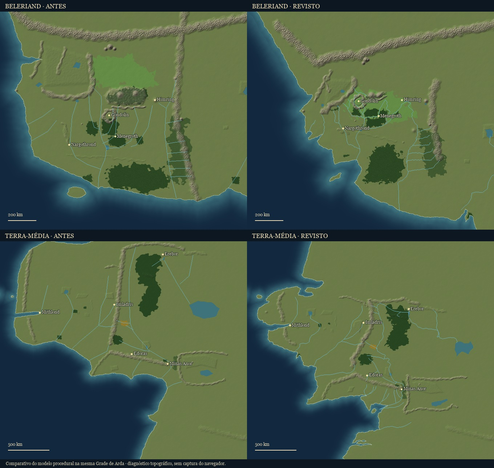

# Revisão cartográfica — 7 de novembro de 2026

Referências consultadas: [Terra-média](http://lotrproject.com/map/) e [Beleriand](http://lotrproject.com/map/beleriand/), do LotrProject, de Emil Johansson. São referências cartográficas secundárias. As fontes literárias, datas e graus de certeza do OpenArda continuam identificados no cadastro; uma posição no desenho não comprova uma altitude, uma fronteira política ou uma data.

## Registro e escala

Os dois mapas usam grades de imagem independentes. Os parâmetros `lat` e `lon` do site não são latitude e longitude geográficas de Arda. Para adaptá-los à Grade de Arda, o atlas mantém Himring/Himling como origem e aplica escalas próprias, sem esticar os eixos separadamente:

| Referência | Origem na grade do LotrProject | Quilômetros por unidade |
|---|---|---|
| Terra-média | `(264, -700,5)` — Himling | `1,0168735713856452` |
| Beleriand | `(2193, -478,5)` — Himring | `0,35` |

A conversão é `GA = (coordenada da referência − origem) × escala`, arredondada ao quilômetro. A escala da Terra-média conserva a indicação de aproximadamente 900 milhas entre Hobbiton e Minas Tirith já usada pelo projeto. A de Beleriand aproxima a extensão do Sirion das 130 léguas citadas no capítulo 14 de *O Silmarillion*. O encaixe entre mapas de eras diferentes continua sendo uma reconstrução.

Os marcos numéricos consultados estão em [tests/fixtures/cartografia-lotrproject.json](../tests/fixtures/cartografia-lotrproject.json). Rótulos costeiros podem ter um pequeno deslocamento para o lado terrestre da costa fractal; a verificação admite até 6 km em relação ao ponto da referência. As imagens e os dados brutos consultados ficam em `fontes-imagens/mapas-lotrproject/`, fora do git. O atlas distribui sua geometria e seu relevo procedural, sem incorporar as texturas do site.

## Cobertura da revisão

| Região | Conferência e ajustes |
|---|---|
| Beleriand | Costa de Nevrast e Falas, Ilha de Balar, posições de Gondolin, Menegroth e Nargothrond, Sirion, Narog, Gelion e afluentes, lagos e bosques. O vale e o modelo 3D de Gondolin foram deslocados juntos. |
| Lindon e Eriador | Himling, Golfo de Lhûn, Forochel, Ered Luin, Evendim, Baranduin, Bruinen, Mitheithel, Gwathló, bosques e estradas. |
| Rhovanion | Montanhas Sombrias, Montanhas Cinzentas, Erebor, Anduin, Celduin, Carnen, Lago Longo, Lothlórien, Fangorn e os contornos compartilhados pelas fases da Floresta Verde/das Trevas. |
| Rohan e Gondor | Ered Nimrais, Isen e Entágua, costa de Andrast e Belfalas, rios de Gondor, estuário do Anduin e Tolfalas. Edoras e Minas Tirith continuam usando suas posições cadastradas para os modelos 3D. |
| Mordor e Rhûn | Ephel Dúath, Ered Lithui, Orodruin, Núrnen e Mar de Rhûn. |
| Númenor | Preservada a revisão anterior baseada no mapa anexado pelo usuário, incluindo portos, relevo e desaparecimento na Queda. |
| Aman e eras anteriores | Sem equivalência nos dois mapas consultados. Mantidas as fontes e reconstruções existentes; a verificação geométrica também cobre suas costas, lugares e polígonos. |
| Extremo norte, leste e sul | Mantidas as extensões inferidas fora do recorte da referência. |

As fronteiras dos reinos acompanham o novo registro espacial, conservando suas fases, natureza e grau de certeza. Elas não foram tratadas como fronteiras políticas comprovadas pelo LotrProject. Foram eliminados cruzamentos de polígonos em Dorthonion e Brethil. As fozes e confluências foram conectadas, inclusive onde a simplificação dos traçados deixava pequenas lacunas.

A continuação do Gelion ao sul do recorte de Beleriand é inferida e está marcada dessa forma nos dados. Tolfalas é desenhada na configuração do continente posterior à Guerra da Ira; esse início de cobertura não é uma data literária de formação da ilha. Altitudes, larguras das cristas, vegetação fina e extrapolações da geografia para outras épocas continuam sendo reconstruções.

## Verificação

O comparativo é uma renderização de diagnóstico do modelo procedural, com as duas versões no mesmo enquadramento; não é uma captura do navegador.

[tests/cartografia.test.ts](../tests/cartografia.test.ts) verifica os marcos da referência, polígonos sem cruzamentos, posições terrestres de lugares ativos, fozes, confluências, conexões das estradas e rotas marítimas e a câmera compartilhada antes/depois da Guerra da Ira. Os testes existentes continuam cobrindo a submersão de Beleriand e Númenor e a integração dos modelos 3D.

Como a grade foi recalibrada, links antigos que guardam apenas coordenadas de câmera podem enquadrar pontos diferentes em relação aos lugares reposicionados. Os IDs dos lugares existentes foram preservados.
