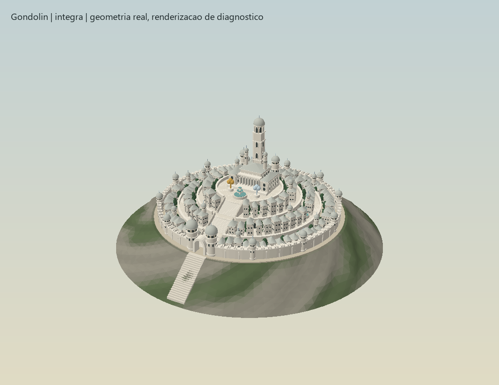
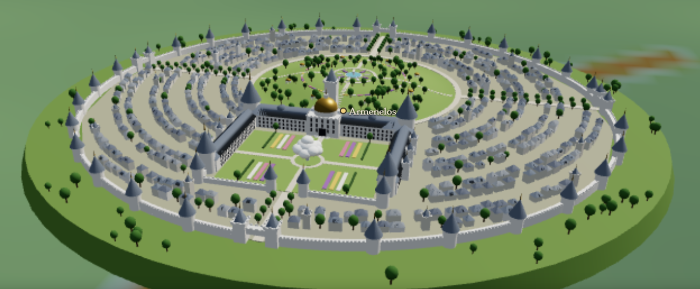
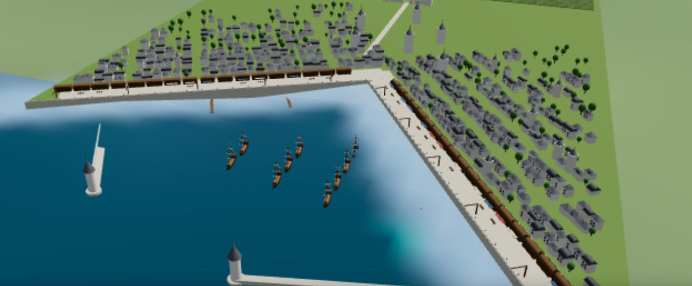
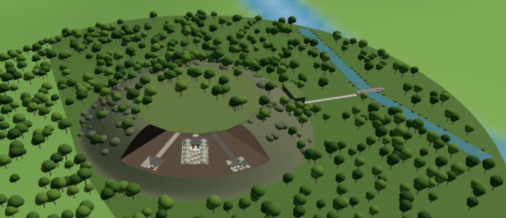
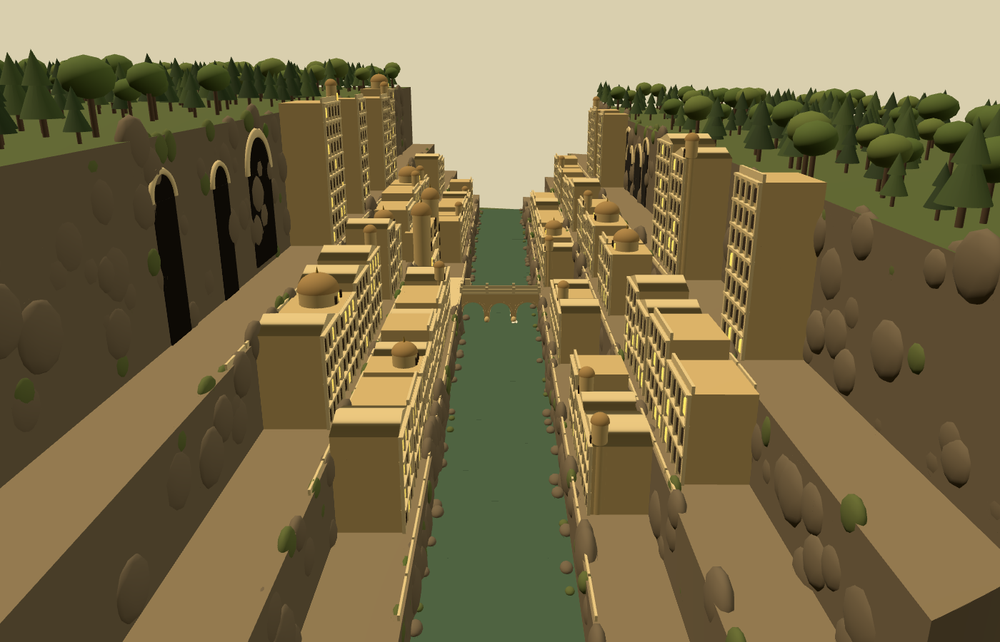
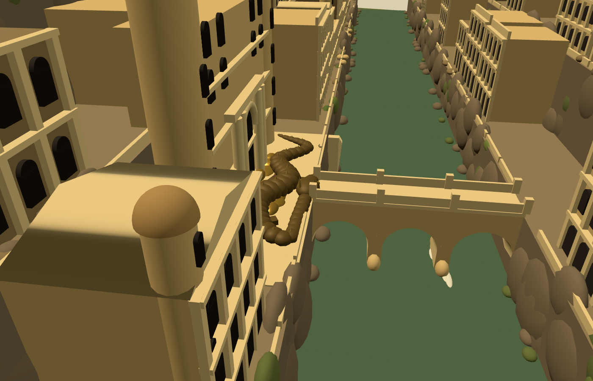

# Roadmap — detalhes dos reinos em 3D

O objetivo é aproximar a câmera de um reino e reconhecer sua arquitetura, suas cidades e suas transformações ao longo do tempo. A camada **Detalhes dos reinos em 3D** complementa as fronteiras políticas e o relevo do atlas. Cada reino começa por uma cidade ou fortaleza representativa. Em 18 de novembro de 2026, os 14 grupos do plano passaram a ter visitas iniciais. As 23 visitas acrescentadas nesta revisão completam 30 entradas no menu **Visitas em 3D**.

## Primeira entrega: Gondolin

**Implementado nesta versão:** representação procedural sobre Amon Gwareth, no vale de Tumladen. A cidade tem uma muralha com entrada, torres, escadaria, bairros, avenidas, jardins, fontes, pátio de Turgon, Torre do Rei e imagens de Glingal e Belthil.

**Revisão de 8 de novembro de 2026:** a arquitetura passou a seguir a fotografia aprovada [Gondolin vista das Echoriath](../public/fotografias/gondolin-pe400.webp). Três terraços elevados e escadarias centrais compõem a subida até o palácio. As fachadas têm janelas em arco, molduras, cornijas e pórticos; torres menores e a Torre do Rei usam lanternins e cúpulas claras. Bairros mais densos, jardins em patamares, fontes de duas bacias e pedra em tons de marfim aproximam a composição da imagem. A base rochosa ganhou irregularidades e variação de pedra/relva. Os terraços são contenções urbanas artísticas; não representam os sete portões de Orfalch Echor.

A imagem acima é uma renderização de diagnóstico da malha real, sem o terreno e a iluminação WebGL do aplicativo. A fotografia original foi preservada. Construção e ruínas compartilham a nova implantação; a planta dos bairros tem semente independente dos danos. Na construção aparecem andaimes e volumes incompletos; nas ruínas faltam cúpulas, jardins e ornamentos, com torres truncadas e escombros.

**Verificação da revisão:** testes de interseção vertical confirmam a avenida central desimpedida e os patamares a 0,03 / 0,25 / 0,48 / 0,72 km sobre a origem local do modelo. Permanecem os testes de apoio da escadaria, exagero do relevo, comparação entre épocas e repetibilidade da geometria. A cidade íntegra usa 23 chamadas de desenho e 163.420 triângulos, contra 20 chamadas e 26.688 triângulos antes; as fases de construção e ruína usam 9 chamadas cada. A criação local do modelo íntegro ficou em aproximadamente 6 ms de mediana, uma vez por fase, mantendo o cache e a criação apenas a menos de 150 km. São medidas da geometria e da geração em Node; FPS real no navegador continua pendente de teste, pois a automação do Chrome não conseguiu abrir a prévia. O build passou com validação dos dados, TypeScript e os 330 testes presentes na execução.

| Período do atlas | Representação |
| --- | --- |
| Antes de 52 P.E. | Sem cidade |
| 52–115 P.E. | Obras: muralhas e edifícios incompletos |
| 116–509 P.E. | Cidade íntegra |
| 510–586 P.E. | Ruínas: torres truncadas, brechas, escombros e ausência de jardins |
| A partir de 587 P.E. | Modelo ocultado após a submersão de Beleriand |

As fronteiras temporais vêm de `data/lugares.json`. A comparação entre épocas desenha o modelo correspondente a cada lado. A construção e as ruínas são estados ilustrativos; não representam a progressão anual da obra ou uma simulação da batalha.

**Como visitar:** abra **Menu → Visitas em 3D → Visitar Gondolin em 3D**, ou a ficha de Gondolin (lugar ou reino) e escolha **Explorar cidade em 3D**. A visita preserva uma época em que existe um modelo; fora dela, abre em 400 P.E. O enquadramento fixo precisa ser destravado para a visita. A camada pode ser desligada independentemente das fronteiras.

**Interpretação visual:** a localização usa a Grade de Arda existente. A malha urbana, os tamanhos, os materiais e as formas dos edifícios são uma reconstrução artística. A muralha da cidade não representa os sete portões da passagem de Orfalch Echor. Não há interiores nem navegação a pé nesta entrega.

**Desempenho:** a geometria só é criada quando a câmera se aproxima a menos de 150 km do centro. Os edifícios repetidos usam instâncias; cada estado é construído uma vez e reutilizado. O exagero do relevo move o assentamento e alonga o suporte rochoso e a escadaria de acesso, preservando as proporções dos edifícios. A visita ajusta a distância da câmera à largura da tela, incluindo o modo de comparação.

### Revisão de 18 de novembro de 2026

O desfiladeiro de Orfalch Echor ganhou uma visita própria, com sete atalhos na ficha. A passagem mostra seis portões a partir de 116 P.E., o Portão de Aço a partir de c. 473, o abandono em 510 e a submersão em 587. A ficha de Gondolin oferece aproximações à entrada urbana, à praça da fonte e à Torre do Rei. Materiais e ordem dos portões seguem *Contos Inacabados*. O atlas interpreta o espaçamento e as datas. [Índice das passagens e remissões](https://tolkiengateway.net/wiki/Seven_Gates_of_Gondolin)

O recorte do vale depende de estudo adicional de relevo e medição em celulares físicos.

## Segunda entrega: Gondor — Minas Tirith

**Implementado nesta versão:** Minas Anor/Minas Tirith na encosta do Mindolluin, com sete níveis escavados na colina, uma muralha e um portão por nível (o Grande Portão a leste, os demais alternando entre sul e norte), muralha externa negra, a proa de rocha que divide os círculos e sobe até a Cidadela, o Pátio da Fonte, a Árvore Branca, a Torre de Ecthelion e o ombro que liga a cidade à montanha, com as casas de Rath Dínen.

| Período do atlas | Representação |
| --- | --- |
| Antes de 3320 S.E. | Sem cidade |
| 3320 S.E.–1 T.E. | Cidade sem a Árvore Branca |
| 2–1635 T.E. | Árvore viva (muda plantada por Isildur) |
| 1636–1639 T.E. | Árvore morta na Grande Peste |
| 1640–2871 T.E. | Árvore replantada por Tarondor |
| 2872–3018 T.E. | Árvore Morta mantida no pátio |
| A partir de 3019 T.E. | Muda plantada por Elessar |

As fronteiras vêm das novas fases de `minas-anor` em `data/lugares.json`; cada fase tem um estado da Árvore em `ARVORE_MINAS_TIRITH`, e um teste exige que as duas listas coincidam. A troca de nome (2002 T.E.) e a reconstrução da Torre Branca (2698 T.E.) aparecem na ficha, sem mudar o modelo.

**Como visitar:** **Menu → Visitas em 3D → Visitar Minas Tirith em 3D**, ou a ficha de Minas Anor ou de Gondor → **Explorar cidade em 3D**. Antes de 3320 S.E., a visita abre em 3018 T.E.

**Interpretação visual:** seguem *O Senhor dos Anéis* (Livro V, cap. 1) os sete níveis com portões alternados, a muralha externa negra, a proa de rocha, os 700 pés da Cidadela sobre a planície e as 50 braças da Torre. O diâmetro, as casas e as ruas são artísticos. A forma de Minas Anor na Segunda Era não é descrita: o modelo usa a mesma cidade em todas as épocas. O cerco de 3019 não é representado, porque a linha do tempo não separa meses dentro de um ano.

**Implantação:** o chão é amostrado no centro e num raio de 650 m; a cidade fica no ponto mais alto, e a rocha da colina e do ombro (abaixo do primeiro círculo) acompanha o exagero do relevo. A camada de detalhes agora é uma lista de sítios em `src/render/detalhes.ts`; as peças repetidas usam `src/render/lotes.ts`, compartilhado com Gondolin.

### Revisão de 18 de novembro de 2026

As visitas de Osgiliath, Rammas Echor e Minas Ithil foram acrescentadas. Osgiliath mostra as duas margens do Anduin, a Cúpula das Estrelas e as etapas de incêndio, abandono e ponte partida. O Rammas acompanha o relevo do Pelennor e abre brechas em 3019 T.E. Minas Ithil mostra a cidade de Isildur, as ruínas do primeiro ataque e a transformação em Minas Morgul. O circuito do Rammas, as plantas e os danos são aproximados.

## Terceira entrega: Rohan — Edoras

**Implementado nesta versão:** Edoras na saída do Vale Harrow, ao pé das Ered Nimrais. A colina verde é cercada por fosso, muralha e cerca de espinhos. O caminho calçado sobe do portão com um canal de água ao lado até a escada de pedra e o terraço verde, onde fica Meduseld, o salão de madeira com telhado dourado. Há casas de madeira com telhado de palha pela encosta e túmulos dos reis com flores de simbelmynë ao lado do caminho, fora do portão.

| Período do atlas | Representação |
| --- | --- |
| Antes de 2569 T.E. | Sem cidade |
| 2569–2757 T.E. | Cidade de Brego; túmulos da primeira linhagem a oeste do caminho |
| 2758 T.E. | Longo Inverno: colina e telhados cobertos de neve (Wulf ocupa Meduseld) |
| 2759 T.E. em diante | Nove túmulos a oeste; a leste, um túmulo por rei da segunda linhagem, de Fréaláf (2798) a Théoden (3019) |

As fases vêm de `edoras` em `data/lugares.json`. O número de túmulos sai dos anos de morte dos reis no Apêndice A (`REIS_ROHAN` em `src/core/detalhes.ts`), e a divisão em nove a oeste e os da segunda linhagem a leste segue o Livro III, cap. 6. Cada combinação de neve e túmulos gera um modelo, criado uma vez e reutilizado.

**Como visitar:** **Menu → Visitas em 3D → Visitar Edoras em 3D**, ou a ficha de Edoras ou de Rohan → **Explorar cidade em 3D**. Antes de 2569 T.E., a visita abre em 3018 T.E.

**Interpretação visual:** são descritos a colina, o fosso, a muralha, a cerca de espinhos, o caminho calçado com o canal, a escada, o terraço, o telhado dourado e os túmulos dos dois lados do caminho. São artísticos o tamanho da colina (cerca de 1 km de diâmetro e 80 m de altura), o número e a forma das casas, as dimensões de Meduseld e o portão ao norte. Como a linha do tempo não separa meses, o ano de 2758 inteiro aparece com neve, embora o Longo Inverno tenha começado em novembro.

**Implantação:** o sítio fica na altura do terreno no centro. A base sob a colina é um talude esticado com o exagero do relevo; em encosta ele aparece como aterro, em vez de deixar a cidade flutuando. Na neve, o talude também fica branco.

### Revisão de 18 de novembro de 2026

O Abismo de Helm ganhou o Forte da Trombeta, o Muro de Helm com bueiro e a entrada de Aglarond. A fase de 3019 mostra uma brecha no muro. O talude de Edoras acompanha a altura e a inclinação do terreno na borda; a cor transita da relva ou neve para tons de terra.

## Quarta entrega: Númenor — Armenelos e Rómenna

**Revisão de 10 de novembro de 2026:** a pedido do usuário, as duas cidades passaram a seguir o visual da série *Os Anéis de Poder* (Prime Video), a partir de imagens de divulgação e de arte conceitual. A série mostra uma única capital à beira-mar. O atlas mantém a geografia de Tolkien: o paço fica em Armenelos, no interior, e o porto com o colosso fica em Rómenna. As fases, as medidas do Templo e os nove navios continuam vindo dos textos. A versão anterior, baseada nas fotografias `armenelos-se3000` e `romenna-se3000`, fica no histórico do git.

- **Armenelos:** o paço fica num pódio ao pé de um penhasco de calcário. A rotunda tem tambor com faixa de janelas azuis e cúpula de bronze; o portal em arco, de moldura azul e ouro, abre-se a leste entre dois pilones. Há uma ala de terraço de ardósia com pavilhões de cúpula dourada e pavilhões cúbicos de treliça azul nos degraus da frente, por onde sobem as escadarias. A Torre do Rei, branca e esguia, fica num rochedo ao lado, ligada ao paço por uma ponte. O pátio do rei é um terraço sobre a grande muralha, que tem arcada, friso de mosaico azul e uma cascata junto ao canto leste; Nimloth floresce no meio do pátio, entre ciprestes. A estátua do rei, com a espada apontada para o chão, fica no encontro da muralha com o paço. Abaixo ficam o bairro em terraço de arcos cegos, o aqueduto de dois andares, o canal com três pontes, a avenida de ciprestes e os bairros de casas de teto plano, com faixas azuis e pequenas cúpulas. A colina no meio da cidade tem jardins e, depois, o Templo.
- **Rómenna:** o cais de pedra acompanha a costa do atlas no fundo da baía, em forma de V. Dois promontórios fecham o porto, e entre eles fica a ponte de três arcos, com atlantes nos pilares e medalhões dourados nos fechos. Na ponta do promontório sul, o farol de pedra tem contrafortes, gabletes e o fogo aceso. No cais sul, o colosso de Eärendil (170 m) ergue o braço esquerdo, com a espada apontada para o chão e Elwing no ombro; às costas tem o rochedo, com casas no alto. Um viaduto liga o rochedo à margem norte, e um aqueduto chega do oeste. Na margem norte ficam a arcada ao nível da água, o terraço de ciprestes com o Salão dos Guardas do Mar e, mais acima, outro rochedo habitado. A cidade alta ocupa o rochedo entre os dois cais. Os navios têm proa e popa altas e velas em leque, abertas no navio que chega e fechadas nos ancorados.

**Referências visuais consultadas:** [8 secrets of Númenor](https://www.aboutamazon.com/news/entertainment/8-secrets-of-numenor-an-unseen-kingdom-in-the-lord-of-the-rings-the-rings-of-power) (vista do paço e arte conceitual da chegada pelo arco), [Dezeen — entrevista com Ramsey Avery](https://www.dezeen.com/2022/09/16/rings-of-power-amazon-production-set-design-architecture-interview/) (vista do porto e ponte dos atlantes) e [GamesRadar — as estátuas de Númenor](https://www.gamesradar.com/the-rings-of-power-numenor-statues-earendil-ulmo) (Eärendil com Elwing no ombro). As imagens serviram só de consulta; nenhuma foi copiada para o repositório.

**Verificação da revisão:** Armenelos usa 51 chamadas de desenho, cerca de 12 mil instâncias e 293 mil triângulos (55 chamadas com o Templo); Rómenna, 71 chamadas, cerca de 5 mil instâncias e 119 mil triângulos. A criação de cada modelo leva de 9 a 27 ms em Node, uma vez por fase. As capturas vêm do aplicativo num Chrome sem interface gráfica, com renderização por software; FPS em hardware real continua pendente.

| Período do atlas | Armenelos | Rómenna |
| --- | --- | --- |
| Antes de 32 S.E. | Sem cidade | Sem porto |
| 32–599 S.E. | Nimloth no pátio do rei | Barcos de pesca |
| 600–3262 S.E. | Nimloth no pátio do rei | Navios de alto-mar ancorados e um chegando pela ponte, de velas abertas |
| c. 3263–3309 S.E. | Toco de Nimloth; Templo de Melkor na colina | Navios de alto-mar |
| 3310–3318 S.E. | Templo de Melkor | Os nove navios dos Fiéis: quatro de Elendil, três de Isildur e dois de Anárion |
| A partir de 3319 S.E. | Modelo ocultado com a Queda | Modelo ocultado com a Queda |

As fronteiras vêm das novas fases de `armenelos` e `romenna` em `data/lugares.json` (`FASES_ARMENELOS` e `FASES_ROMENNA` em `src/core/detalhes.ts`), e um teste exige que coincidam. O ano do Templo (c. 3263) é o mesmo inferido no acontecimento `se-nimloth`, pois a Akallabêth não o dá. A ligação dos navios de Elendil a Rómenna em 3310 também é inferida: a partir do ano da Grande Armada.

**Como visitar:** no menu **Visitas em 3D**, escolha **Visitar Armenelos em 3D** ou **Visitar Rómenna em 3D**. Também é possível abrir a ficha de Armenelos, de Rómenna ou de Númenor e escolher **Explorar cidade em 3D**. Fora do período das cidades, a visita abre em 3000 S.E.

**Interpretação visual:** a Akallabêth descreve Nimloth no pátio do rei e o Templo na colina no meio da cidade. O Templo era circular, com 500 pés de diâmetro na base e 500 pés de altura até a cúpula de prata, que logo enegreceu com a fumaça. O modelo usa essas medidas e mostra a cúpula já escura. O porto no fundo de uma baía voltada para a Terra-média e a partida dos Fiéis vêm de *Contos Inacabados* e da Akallabêth. Todo o resto é escolha da série ou composição do atlas, não descrição de Tolkien: o paço, o penhasco, a muralha, a cascata, a estátua do rei, a forma da Torre do Rei, o colosso, o farol, a ponte dos atlantes, os viadutos, as casas e os navios de velas em leque. A série reúne paço e porto numa só cidade; o atlas os separa para manter Armenelos no interior.

**Implantação:** Armenelos fica sobre uma base em talude, como Edoras; o penhasco, o rochedo da torre e os patamares da encosta são uma só malha (`Rochas`), com cores por vértice. A visita olha de lés-sudeste, com o Meneltarma do atlas ao fundo. O marcador e o modelo de Rómenna usam o mesmo ponto de assentamento em `CAIS_ROMENNA`, junto à costa no fundo da baía. A extrusão da terra tem relva no topo e a muralha do cais nas faces. O grupo `Mar` é recolocado a cada quadro no nível da água, abaixo do chão da cidade; nele ficam os promontórios, a ponte, o farol, os píeres e os navios. A ponte cruza água do atlas, e um teste confere isso e a posição do colosso em terra, junto ao cais.

### Revisão de 18 de novembro de 2026

O Meneltarma ganhou uma estrada em espiral que acompanha o relevo até o cume aberto, com a [fotografia do Meneltarma em 3000 S.E.](../public/fotografias/meneltarma-se3000.webp) na ficha. Andúnië ganhou um cais, com uma visita independente à Grande Armada de 3310 a 3318 S.E. A posição da frota ao largo do porto é ilustrativa. Calmindon fica numa ilhota de Tol Uinen. Os marcadores de Rómenna e Andúnië foram alinhados à implantação dos portos, com as estradas e rotas conectadas.

## Quinta entrega: Doriath — Menegroth

**Implementado nesta versão:** as Mil Cavernas de Thingol e Melian, numa colina rochosa da floresta de faias, na margem sul do Esgalduin. O exterior segue a fotografia aprovada [A entrada de Menegroth](../public/fotografias/menegroth-pe400.webp): uma única ponte de pedra em arco sobre o rio, o caminho calçado e o portal cavado na encosta, com faias e colunas em relevo, portas de madeira e degraus. A colina tem topo musgoso, afloramentos de rocha e árvores.

**Modo de corte:** um setor de 80° da colina, voltado para a câmera da visita, fica aberto como numa maquete em corte. A rocha do setor é uma laje cortada na altura do teto dos salões. Os salões e corredores são furos reais da extrusão, e as paredes dos furos são as paredes escavadas. Acima do teto, as faces da seção fecham a colina. Pelo corte se veem o salão do trono, com duas fileiras de pilares em forma de faia, lanternas de ouro, piso de pedras de muitas cores e os tronos de Thingol e Melian num estrado de mármore; o salão da fonte, com a bacia de mármore e a fonte de prata; a câmara do tesouro; e os corredores iluminados.

| Período do atlas | Representação |
| --- | --- |
| Antes da fundação (Anos das Árvores) | Sem salões |
| Fundação até 502 P.E. | Salões íntegros, lanternas acesas |
| c. 503 P.E. | Saqueada pelos Anões: sem lanternas, tesouro e tronos; escombros |
| 504–505 P.E. | Restaurada por Dior |
| 506–586 P.E. | Destruída pelos filhos de Fëanor: portas arrombadas, pilares caídos, fonte seca, mais escombros |
| A partir de 587 P.E. | Modelo ocultado com o afundamento de Beleriand |

As fases vêm de `menegroth` em `data/lugares.json` (`FASES_MENEGROTH`), e um teste exige que coincidam.

**Como visitar:** no menu **Visitas em 3D**, escolha **Visitar Menegroth em 3D**. Também é possível abrir a ficha de Menegroth ou de Doriath e escolher **Explorar cidade em 3D**. Durante a existência dos salões, a visita preserva a época, inclusive nos Anos das Árvores, sob a luz de Telperion e Laurelin. Fora dela, abre em 400 P.E.

**Interpretação visual:** *O Silmarillion* (cap. 10) descreve a ponte única, os pilares esculpidos como as faias de Oromë, com tronco, galhos e folhas, as lanternas de ouro, as fontes de prata, as bacias de mármore e os pisos de pedras de muitas cores. A forma da colina, a planta e o número de salões, o portal e o corte são artísticos.

**Implantação:** o marcador e o modelo usam `COLINA_MENEGROTH`, na margem sul do Esgalduin. A curva do rio no modelo coincide com um vértice do traçado do atlas (um teste confere), e o trecho em 3D segue as duas pernas desse traçado até a borda da base. As peças compartilhadas com Númenor (torres, telhados, árvores, navios) ficam em `src/render/oficina.ts`.

### Revisão de 18 de novembro de 2026

A ficha de Menegroth oferece a visita em corte e uma opção para fechar a colina. A nova visita Cinturão de Melian acompanha o contorno de Doriath com névoa, da Primeira Batalha de Beleriand até a partida de Melian em c. 503 P.E. A névoa é uma interpretação do encantamento. O marcador de Menegroth passou para a margem sul do Esgalduin.

## Sexta entrega: Nargothrond

**Implementado nesta versão (revisão de 10 de novembro de 2026):** a garganta do Narog sob Taur-en-Faroth, com a composição de uma ilustração de referência indicada pelo usuário, que substitui a primeira versão em corte. Os paredões sobem em quatro degraus de cada lado do rio, até a floresta no alto. Nos três primeiros degraus há fachadas escavadas em pedra dourada: pilastras, cornijas, andares de janelas em arco, frontões baixos, balaustradas, cúpulas e torreões. O degrau mais alto é paredão, com grandes bocas de caverna em arco. No primeiro degrau da margem oeste ficam a praça e as Portas de Felagund: o portal em arco com colunas, os dois torreões com cúpula e uma escada até a água. Diante das portas, a ponte de três arcos plenos atravessa o Narog, com tímpanos, aduelas e parapeitos.

As duas imagens são renderizações de diagnóstico da malha real, sem o terreno e a iluminação do aplicativo. O FPS no navegador do aplicativo não foi medido nesta entrega.

| Período do atlas | Representação |
| --- | --- |
| Antes de 102 P.E. | Sem cidade |
| 102–489 P.E. | Fachadas íntegras, parte das janelas acesas, sem ponte |
| c. 490–494 P.E. | A grande ponte diante das portas, construída a conselho de Túrin |
| 495–500 P.E. | Saque: janelas apagadas, edifícios queimados ou partidos, portas arrombadas e escombros; Glaurung sobre o ouro na praça das portas |
| c. 501–586 P.E. | Glaurung partiu para Brethil e o tesouro foi levado a Doriath; ruínas tomadas pelo mato |
| A partir de 587 P.E. | Modelo ocultado com o afundamento de Beleriand |

As fases vêm de `nargothrond` em `data/lugares.json` (`FASES_NARGOTHROND`), e um teste exige que coincidam. Foram acrescentadas duas fases ao lugar, ambas com data aproximada: a ponte (c. 490, logo depois da chegada de Túrin, quando a fotografia das portas sem ponte deixa de valer) e a partida de Glaurung (501, ano da morte do dragão em Cabed-en-Aras). A ponte continua de pé depois do saque, pois foi por ela que Glaurung entrou.

**Como visitar:** no menu **Visitas em 3D**, escolha **Visitar Nargothrond em 3D**. Também é possível abrir a ficha de Nargothrond, lugar ou reino, e escolher **Explorar cidade em 3D**. A visita olha rio acima pela garganta. Fora do período da cidade, ela abre em 400 P.E.

**Interpretação visual:** *O Silmarillion* (cap. 13 e 21) descreve as cavernas sob Taur-en-Faroth na margem oeste do Narog, as portas voltadas para o rio, a grande ponte construída a conselho de Túrin e Glaurung, que entra pela ponte e encontra Túrin diante das portas antes de se deitar sobre o tesouro lá dentro. Seguem a ilustração de referência, e são portanto artísticos, a garganta em degraus, as fachadas nas duas margens (o texto só fala da margem oeste), as cúpulas, as bocas de caverna, as três arcadas da ponte e o tom dourado da pedra. A forma de Glaurung (sem asas) também é artística. O dragão fica do lado de fora para ser visto.

**Implantação:** o marcador e o modelo usam `MARGEM_NARGOTHROND`, na margem oeste. O giro `GIRO_NARGOTHROND` alinha a garganta ao traçado do rio no atlas. Um teste confere que o eixo do rio cai sobre esse trecho e que o centro do sítio fica na margem oeste.

### Revisão de 18 de novembro de 2026

A ficha alterna a garganta e os salões em corte. O interior usa uma planta artística com pilares e luzes, e mostra o tesouro durante a ocupação de Glaurung. O marcador de Nargothrond passou para a margem oeste do Narog.

## Cobertura do plano de expansão

| Ordem | Reino ou domínio | Visitas implementadas |
| --- | --- | --- |
| 1 | Gondolin | Cidade e pontos de interesse, Orfalch Echor e os sete portões. |
| 2 | Gondor | Minas Tirith, Osgiliath, Rammas Echor e Minas Ithil/Minas Morgul. |
| 3 | Rohan | Edoras e Abismo de Helm, com o Muro de Helm e a entrada de Aglarond. |
| 4 | Númenor | Armenelos, Rómenna, Tol Uinen, Meneltarma, Andúnië e Grande Armada. |
| 5 | Doriath | Menegroth em corte ou pelo exterior e Cinturão de Melian até c. 503 P.E. |
| 6 | Nargothrond | Garganta, Portas de Felagund, ponte, Glaurung e salões em corte. |
| 7 | Lindon e Eregion | Mithlond com cais e estaleiro. Ost-in-Edhil com oficinas élficas e ruínas de 1697 S.E. em diante. |
| 8 | Arnor e Arthedain | Annúminas junto ao Nenuial, com abandono e restauração. Fornost murada, depois em ruínas. |
| 9 | Angmar | Carn Dûm, com um acesso de montanha interpretativo. |
| 10 | Mordor | Barad-dûr em construção, íntegra, nos alicerces da Segunda Era e em ruínas após 3019 T.E. |
| 11 | Domínio de Morgoth | Entrada fortificada de Angband ao pé de Thangorodrim, até a submersão. |
| 12 | Valinor | Tirion em terraços com a lâmpada de Ingwë em Túna e as torres de sinos de Valmar, sob a iluminação da era. |
| 13 | Reinos anões | Khazad-dûm, com a Porta Oeste, salões e a colônia de Balin. Erebor, com a Porta Principal, as fases de ocupação e o tesouro de Smaug. |
| 14 | Reinos élficos da Terceira Era | Caras Galadhon com plataformas nos mallorns e salões de Thranduil, com ponte, adegas e saída dos barris. |

As fichas dessas visitas indicam as fontes literárias e os pontos de interpretação. Os reinos de Khazad-dûm, Erebor e Lothlórien foram cadastrados com seus centros e períodos e ainda aguardam limites políticos. Os salões de Thranduil usam o cadastro do Reino da Floresta, com os contornos e a sucessão de Oropher e Thranduil. As datas do modelo foram marcadas como aproximadas quando as obras não dão um ano.

A revisão no Chrome usou 1280 × 800 e 390 × 844. A renderização em software permitiu conferir a busca, as fichas e o enquadramento por amostragem. A correção do globo preserva os ladrilhos próximos à câmera e mantém o oceano de fundo atrás do terreno do atlas. Medições de FPS e testes de toque em aparelhos físicos continuam abertos.

## Critérios para concluir cada reino

- Cidade localizável pela busca, pela ficha e por um atalho de visita.
- Modelo assentado no relevo, sem aparecer antes da fundação ou depois da remoção/submersão.
- Comparação entre épocas correta, inclusive quando só um dos lados tem arquitetura.
- Camada independente, detalhes limitados à escala local e reutilização de geometrias.
- Fontes, diferenças entre versões e reconstruções artísticas identificadas na ficha.
- Testes de fronteiras temporais, geração determinística, visibilidade e integração; validação dos dados, tipos e build aprovados.
- Inspeção visual em desktop e celular, incluindo zoom, relevo exagerado e comparação. Medir desempenho em hardware real antes de fixar metas de FPS.

## Referências para a primeira entrega

- **O Silmarillion**, “Dos Noldor em Beleriand” e “De Tuor e da Queda de Gondolin”: base narrativa já registrada no atlas.
- **Contos Inacabados**, “De Tuor e sua chegada a Gondolin”: referência para o acesso pelo vale e os portões.
- [Tolkien Gateway — Gondolin](https://tolkiengateway.net/wiki/Gondolin): consulta secundária para conferir muralhas claras, Torre do Rei, fontes e as imagens de Glingal e Belthil. A planta e os volumes deste projeto são autorais; não foram copiados de mapas ou adaptações.

As fontes secundárias não substituem o cotejo das edições. O projeto continua distinguindo o relato publicado das versões antigas; esta entrega não incorpora nomes de ruas ou bairros exclusivos dessas versões.
