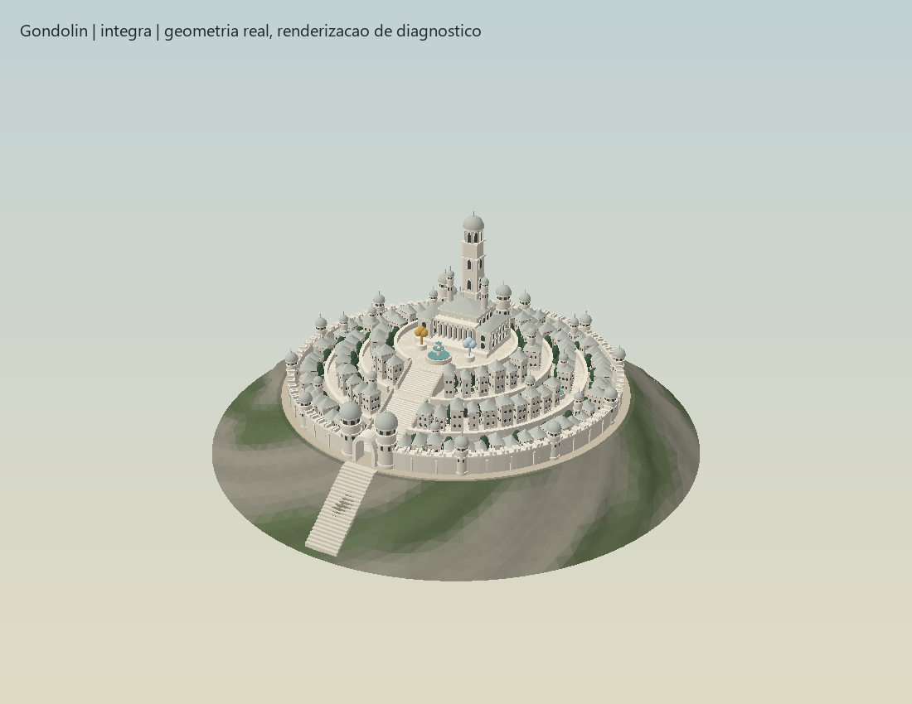
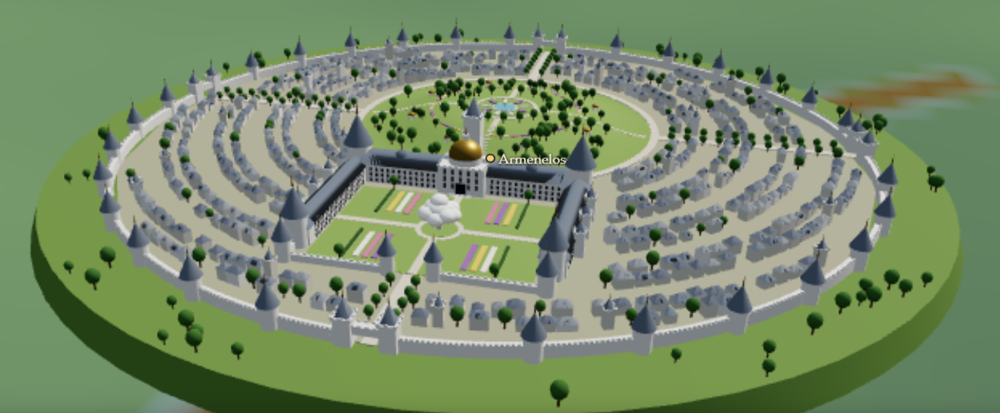
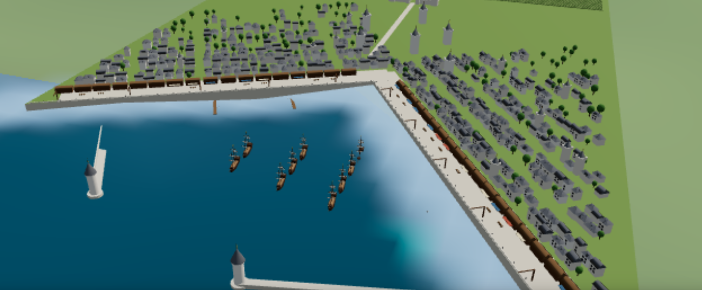
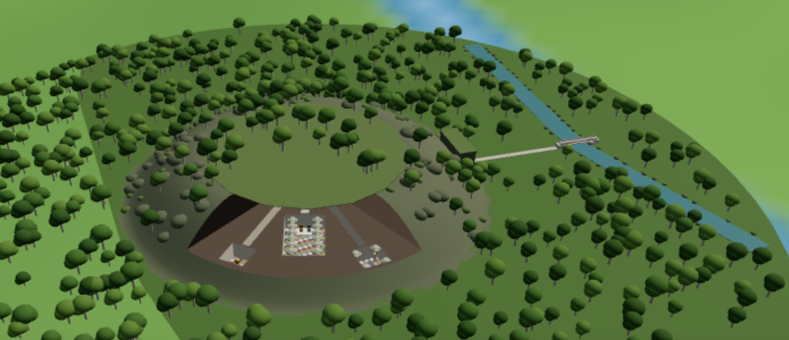

# Roadmap — detalhes dos reinos em 3D

O objetivo é aproximar a câmera de um reino e reconhecer sua arquitetura, suas cidades e suas transformações ao longo do tempo. A camada **Detalhes dos reinos em 3D** complementa as fronteiras políticas e o relevo do atlas. Cada reino começa por uma cidade ou fortaleza representativa.

## Primeira entrega: Gondolin

**Implementado nesta versão:** representação procedural sobre Amon Gwareth, no vale de Tumladen. A cidade tem uma muralha com entrada, torres, escadaria, bairros, avenidas, jardins, fontes, pátio de Turgon, Torre do Rei e imagens de Glingal e Belthil.

**Revisão de 8 de novembro de 2026:** a arquitetura passou a seguir a fotografia aprovada [Gondolin vista das Echoriath](../public/fotografias/gondolin-pe400.webp). Três terraços elevados e escadarias centrais compõem a subida até o palácio. As fachadas têm janelas em arco, molduras, cornijas e pórticos; torres menores e a Torre do Rei usam lanternins e cúpulas claras. Bairros mais densos, jardins em patamares, fontes de duas bacias e pedra em tons de marfim aproximam a composição da imagem. A base rochosa ganhou irregularidades e variação de pedra/relva. Os terraços são contenções urbanas artísticas; não representam os sete portões de Orfalch Echor.

A imagem acima é uma renderização de diagnóstico da malha real, sem o terreno e a iluminação WebGL do aplicativo. A fotografia original foi preservada. Construção e ruínas compartilham a nova implantação; a planta dos bairros tem semente independente dos danos. Na construção aparecem andaimes e volumes incompletos; nas ruínas faltam cúpulas, jardins e ornamentos, com torres truncadas e escombros.

**Verificação da revisão:** testes de interseção vertical confirmam a avenida central desimpedida e os patamares a 0,03 / 0,25 / 0,48 / 0,72 km sobre a origem local do modelo. Permanecem os testes de apoio da escadaria, exagero do relevo, comparação entre épocas e repetibilidade da geometria. A cidade íntegra usa 23 chamadas de desenho e 163.420 triângulos, contra 20 chamadas e 26.688 triângulos antes; as fases de construção e ruína usam 9 chamadas cada. A criação local do modelo íntegro ficou em aproximadamente 6 ms de mediana, uma vez por fase, mantendo o cache e a criação apenas a menos de 150 km. São medidas da geometria e da geração em Node; FPS real no navegador continua pendente de teste, pois a automação do Chrome não conseguiu abrir a prévia. O build passou com validação dos dados, TypeScript e os 330 testes presentes na execução.

| Período do atlas | Representação |
| --- | --- |
| Antes de 52 P.E. | Sem cidade |
| 52–115 P.E. | Obras: muralhas e edifícios incompletos |
| 116–509 P.E. | Cidade íntegra |
| 510–586 P.E. | Ruínas: torres truncadas, brechas, escombros e ausência de jardins |
| A partir de 587 P.E. | Modelo ocultado após a submersão de Beleriand |

As fronteiras temporais vêm de `data/lugares.json`. A comparação entre épocas desenha o modelo correspondente a cada lado. A construção e as ruínas são estados ilustrativos; não representam a progressão anual da obra ou uma simulação da batalha.

**Como visitar:** abra **Camadas e legenda → Visitar Gondolin em 3D**, ou a ficha de Gondolin (lugar ou reino) e escolha **Explorar cidade em 3D**. A visita preserva uma época em que existe um modelo; fora dela, abre em 400 P.E. O enquadramento fixo precisa ser destravado para a visita. A camada pode ser desligada independentemente das fronteiras.

**Interpretação visual:** a localização usa a Grade de Arda existente. A malha urbana, os tamanhos, os materiais e as formas dos edifícios são uma reconstrução artística. A muralha da cidade não representa os sete portões da passagem de Orfalch Echor. Não há interiores nem navegação a pé nesta entrega.

**Desempenho:** a geometria só é criada quando a câmera se aproxima a menos de 150 km do centro. Os edifícios repetidos usam instâncias; cada estado é construído uma vez e reutilizado. O exagero do relevo move o assentamento e alonga o suporte rochoso e a escadaria de acesso, preservando as proporções dos edifícios. A visita ajusta a distância da câmera à largura da tela, incluindo o modo de comparação.

### Próximos detalhes de Gondolin

- Modelar os sete portões ao longo de Orfalch Echor, usando o traçado da passagem existente. Distinguir sua localização inferida do material descrito nas fontes.
- Acrescentar pontos de interesse selecionáveis na praça, na torre e na entrada, com fontes específicas.
- Estudar um recorte do vale com aproximação gradual de detalhes e perfis de desempenho em celulares reais.
- Refinar a implantação após cotejar as descrições de Tolkien; manter as dimensões não documentadas como artísticas.

## Segunda entrega: Gondor — Minas Tirith

**Implementado nesta versão:** Minas Anor/Minas Tirith na encosta do Mindolluin, com sete níveis escavados na colina, uma muralha e um portão por nível (o Grande Portão a leste, os demais alternando entre sul e norte), muralha externa negra, a proa de rocha que divide os círculos e sobe até a Cidadela, o Pátio da Fonte, a Árvore Branca, a Torre de Ecthelion e o ombro que liga a cidade à montanha, com as casas de Rath Dínen.

| Período do atlas | Representação |
| --- | --- |
| Antes de 3320 S.E. | Sem cidade |
| 3320 S.E.–1 T.E. | Cidade sem a Árvore Branca |
| 2–1635 T.E. | Árvore viva (muda plantada por Isildur) |
| 1636–1639 T.E. | Árvore morta na Grande Peste |
| 1640–2871 T.E. | Árvore replantada por Tarondor |
| 2872–3018 T.E. | Árvore Morta mantida no pátio |
| A partir de 3019 T.E. | Muda plantada por Elessar |

As fronteiras vêm das novas fases de `minas-anor` em `data/lugares.json`; cada fase tem um estado da Árvore em `ARVORE_MINAS_TIRITH`, e um teste exige que as duas listas coincidam. A troca de nome (2002 T.E.) e a reconstrução da Torre Branca (2698 T.E.) aparecem na ficha, sem mudar o modelo.

**Como visitar:** **Camadas e legenda → Visitar Minas Tirith em 3D**, ou a ficha de Minas Anor ou de Gondor → **Explorar cidade em 3D**. Antes de 3320 S.E., a visita abre em 3018 T.E.

**Interpretação visual:** seguem *O Senhor dos Anéis* (Livro V, cap. 1) os sete níveis com portões alternados, a muralha externa negra, a proa de rocha, os 700 pés da Cidadela sobre a planície e as 50 braças da Torre. O diâmetro, as casas e as ruas são artísticos. A forma de Minas Anor na Segunda Era não é descrita: o modelo usa a mesma cidade em todas as épocas. O cerco de 3019 não é representado, porque a linha do tempo não separa meses dentro de um ano.

**Implantação:** o chão é amostrado no centro e num raio de 650 m; a cidade fica no ponto mais alto, e a rocha da colina e do ombro (abaixo do primeiro círculo) acompanha o exagero do relevo. A camada de detalhes agora é uma lista de sítios em `src/render/detalhes.ts`; as peças repetidas usam `src/render/lotes.ts`, compartilhado com Gondolin.

### Próximos detalhes de Gondor

- Osgiliath dos dois lados do Anduin, com a ponte e as ruínas de 1437 T.E. em diante.
- O Rammas Echor em volta do Pelennor, numa escala acima da cidade.
- Minas Ithil/Minas Morgul, reutilizando a estrutura de sítios.
- Inspeção em celulares reais.

## Terceira entrega: Rohan — Edoras

**Implementado nesta versão:** Edoras na saída do Vale Harrow, ao pé das Ered Nimrais. A colina verde é cercada por fosso, muralha e cerca de espinhos. O caminho calçado sobe do portão com um canal de água ao lado até a escada de pedra e o terraço verde, onde fica Meduseld, o salão de madeira com telhado dourado. Há casas de madeira com telhado de palha pela encosta e túmulos dos reis com flores de simbelmynë ao lado do caminho, fora do portão.

| Período do atlas | Representação |
| --- | --- |
| Antes de 2569 T.E. | Sem cidade |
| 2569–2757 T.E. | Cidade de Brego; túmulos da primeira linhagem a oeste do caminho |
| 2758 T.E. | Longo Inverno: colina e telhados cobertos de neve (Wulf ocupa Meduseld) |
| 2759 T.E. em diante | Nove túmulos a oeste; a leste, um túmulo por rei da segunda linhagem, de Fréaláf (2798) a Théoden (3019) |

As fases vêm de `edoras` em `data/lugares.json`. O número de túmulos sai dos anos de morte dos reis no Apêndice A (`REIS_ROHAN` em `src/core/detalhes.ts`), e a divisão em nove a oeste e os da segunda linhagem a leste segue o Livro III, cap. 6. Cada combinação de neve e túmulos gera um modelo, criado uma vez e reutilizado.

**Como visitar:** **Camadas e legenda → Visitar Edoras em 3D**, ou a ficha de Edoras ou de Rohan → **Explorar cidade em 3D**. Antes de 2569 T.E., a visita abre em 3018 T.E.

**Interpretação visual:** são descritos a colina, o fosso, a muralha, a cerca de espinhos, o caminho calçado com o canal, a escada, o terraço, o telhado dourado e os túmulos dos dois lados do caminho. São artísticos o tamanho da colina (cerca de 1 km de diâmetro e 80 m de altura), o número e a forma das casas, as dimensões de Meduseld e o portão ao norte. Como a linha do tempo não separa meses, o ano de 2758 inteiro aparece com neve, embora o Longo Inverno tenha começado em novembro.

**Implantação:** o sítio fica na altura do terreno no centro. A base sob a colina é um talude esticado com o exagero do relevo; em encosta ele aparece como aterro, em vez de deixar a cidade flutuando. Na neve, o talude também fica branco.

### Próximos detalhes de Rohan

- O Abismo de Helm e o Forte da Trombeta, com o Muro de Helm e Aglarond.
- Fazer o talude acompanhar o terreno em volta, em vez de usar uma cor única.
- Inspeção em celulares reais.

## Quarta entrega: Númenor — Armenelos e Rómenna

**Implementado nesta versão:** as duas cidades seguem as fotografias aprovadas [Armenelos, a cidade dos reis](../public/fotografias/armenelos-se3000.webp) e [Rómenna](../public/fotografias/romenna-se3000.webp): pedra branca, telhados de ardósia, torres com coruchéus e finais dourados.

- **Armenelos:** uma muralha branca com ameias, torres redondas e quatro portões. As avenidas arborizadas partem dos portões, e os bairros se organizam em anéis, cortados por vielas, em volta da colina central. A colina tem jardins, fonte, pavilhões de cúpula dourada e bosques. A leste fica o paço do rei: corpo principal com pavilhão de cúpula dourada, alas em U, torres de canto, fileiras de janelas e a Torre do Rei. No meio do pátio, Nimloth floresce entre canteiros e sebes.
- **Rómenna:** o cais de pedra acompanha a costa do atlas no fundo da baía, em forma de V. Há passeio com parapeito, frades de amarração, guindastes e armazéns de madeira com toldos. Molhes com faróis fecham o porto, e píeres de madeira avançam sobre a água. As casas e torres de pedra rareiam terra adentro até a cidadela, que tem muralha, torre de menagem e salão. Atrás ficam os terraços de vinhas. Navios e barcos ficam no nível do mar.

| Período do atlas | Armenelos | Rómenna |
| --- | --- | --- |
| Antes de 32 S.E. | Sem cidade | Sem porto |
| 32–599 S.E. | Nimloth no pátio do rei | Barcos de pesca |
| 600–3262 S.E. | Nimloth no pátio do rei | Navios de alto-mar ancorados e um entrando a vela |
| c. 3263–3309 S.E. | Toco de Nimloth; Templo de Melkor na colina | Navios de alto-mar |
| 3310–3318 S.E. | Templo de Melkor | Os nove navios dos Fiéis: quatro de Elendil, três de Isildur e dois de Anárion |
| A partir de 3319 S.E. | Modelo ocultado com a Queda | Modelo ocultado com a Queda |

As fronteiras vêm das novas fases de `armenelos` e `romenna` em `data/lugares.json` (`FASES_ARMENELOS` e `FASES_ROMENNA` em `src/core/detalhes.ts`), e um teste exige que coincidam. O ano do Templo (c. 3263) é o mesmo inferido no acontecimento `se-nimloth`, pois a Akallabêth não o dá. A ligação dos navios de Elendil a Rómenna em 3310 também é inferida: a partir do ano da Grande Armada.

**Como visitar:** em **Camadas e legenda**, escolha **Visitar Armenelos em 3D** ou **Visitar Rómenna em 3D**. Também é possível abrir a ficha de Armenelos, de Rómenna ou de Númenor e escolher **Explorar cidade em 3D**. Fora do período das cidades, a visita abre em 3000 S.E.

**Interpretação visual:** a Akallabêth descreve Nimloth no pátio do rei e o Templo na colina no meio da cidade. O Templo era circular, com 500 pés de diâmetro na base e 500 pés de altura até a cúpula de prata, que logo enegreceu com a fumaça. O modelo usa essas medidas e mostra a cúpula já escura. O porto no fundo de uma baía voltada para a Terra-média e a partida dos Fiéis vêm de *Contos Inacabados* e da Akallabêth. Traçado, paço, jardins, casas, cidadela, faróis e navios são artísticos.

**Implantação:** Armenelos fica sobre uma base em talude, como Edoras. O marcador de Rómenna no mapa fica cerca de 12 km terra adentro. Por isso, o porto é assentado em `CAIS_ROMENNA`, no fundo da baía, onde a costa do atlas encontra o mar, e fica mais perto do chão (`folga`), para o cais não flutuar. A extrusão da terra tem relva no topo e a muralha do cais nas faces. O grupo `Mar` é recolocado a cada quadro no nível da água, abaixo do chão da cidade.

### Próximos detalhes de Númenor

- Tol Uinen e a torre Calmindon, na baía de Rómenna.
- O Meneltarma: a estrada em espiral e o santuário aberto no cume, reutilizando a fotografia `meneltarma-se3000`.
- Andúnië, no oeste, e a Grande Armada.
- Decidir se o marcador de Rómenna deve ir para a costa (revisão cartográfica).

## Quinta entrega: Doriath — Menegroth

**Implementado nesta versão:** as Mil Cavernas de Thingol e Melian, numa colina rochosa da floresta de faias, na margem sul do Esgalduin. O exterior segue a fotografia aprovada [A entrada de Menegroth](../public/fotografias/menegroth-pe400.webp): uma única ponte de pedra em arco sobre o rio, o caminho calçado e o portal cavado na encosta, com faias e colunas em relevo, portas de madeira e degraus. A colina tem topo musgoso, afloramentos de rocha e árvores.

**Modo de corte:** um setor de 80° da colina, voltado para a câmera da visita, fica aberto como numa maquete em corte. A rocha do setor é uma laje cortada na altura do teto dos salões. Os salões e corredores são furos reais da extrusão, e as paredes dos furos são as paredes escavadas. Acima do teto, as faces da seção fecham a colina. Pelo corte se veem o salão do trono, com duas fileiras de pilares em forma de faia, lanternas de ouro, piso de pedras de muitas cores e os tronos de Thingol e Melian num estrado de mármore; o salão da fonte, com a bacia de mármore e a fonte de prata; a câmara do tesouro; e os corredores iluminados.

| Período do atlas | Representação |
| --- | --- |
| Antes da fundação (Anos das Árvores) | Sem salões |
| Fundação até 502 P.E. | Salões íntegros, lanternas acesas |
| c. 503 P.E. | Saqueada pelos Anões: sem lanternas, tesouro e tronos; escombros |
| 504–505 P.E. | Restaurada por Dior |
| 506–586 P.E. | Destruída pelos filhos de Fëanor: portas arrombadas, pilares caídos, fonte seca, mais escombros |
| A partir de 587 P.E. | Modelo ocultado com o afundamento de Beleriand |

As fases vêm de `menegroth` em `data/lugares.json` (`FASES_MENEGROTH`), e um teste exige que coincidam.

**Como visitar:** em **Camadas e legenda**, escolha **Visitar Menegroth em 3D**. Também é possível abrir a ficha de Menegroth ou de Doriath e escolher **Explorar cidade em 3D**. Durante a existência dos salões, a visita preserva a época, inclusive nos Anos das Árvores, sob a luz de Telperion e Laurelin. Fora dela, abre em 400 P.E.

**Interpretação visual:** *O Silmarillion* (cap. 10) descreve a ponte única, os pilares esculpidos como as faias de Oromë, com tronco, galhos e folhas, as lanternas de ouro, as fontes de prata, as bacias de mármore e os pisos de pedras de muitas cores. A forma da colina, a planta e o número de salões, o portal e o corte são artísticos. O Cinturão de Melian não é representado.

**Implantação:** o marcador de Menegroth no mapa fica a cerca de 5 km do traçado do Esgalduin. O modelo é assentado em `COLINA_MENEGROTH`, na margem sul. A curva do rio no modelo coincide com um vértice do traçado do atlas (um teste confere), e o trecho em 3D segue as duas pernas desse traçado até a borda da base. As peças compartilhadas com Númenor (torres, telhados, árvores, navios) ficam em `src/render/oficina.ts`.

### Próximos detalhes de Doriath

- Uma alternância do corte (aberto ou fechado) na ficha da visita.
- O Cinturão de Melian como efeito de névoa nas bordas do reino.
- Decidir se o marcador de Menegroth deve ir para a margem do rio (revisão cartográfica).

## Ordem de expansão

Esta é uma ordem de implementação, sem datas prometidas. Gondolin, Minas Tirith, Edoras, Armenelos, Rómenna e Menegroth já têm arquitetura 3D; os demais itens estão planejados.

| Ordem | Reino / domínio | Primeiro local | Entrega visual e temporal | Dependência principal |
| --- | --- | --- | --- | --- |
| 1 | **Gondolin** | Gondolin | **Versão inicial implementada**; depois, passagem e sete portões | Validar e refinar a primeira cidade |
| 2 | **Gondor** | Minas Anor / Minas Tirith | **Versão inicial implementada** (cidadela, níveis, muralhas e relação com Mindolluin); depois, Osgiliath e suas ruínas | Definir versões por época a partir das fases dos lugares |
| 3 | **Rohan** | Edoras | **Versão inicial implementada** (colina, fosso, muralha, Meduseld, túmulos e Longo Inverno); depois, o Abismo de Helm | Arquitetura de madeira e implantação no relevo |
| 4 | **Númenor** | Armenelos e Rómenna | **Versão inicial implementada** (paço, Nimloth, Templo, porto e frotas por época; desaparecimento na Queda); depois, o Meneltarma e Andúnië | Relacionar os assentamentos à geografia da ilha |
| 5 | **Doriath** | Menegroth | **Versão inicial implementada** (entrada, ponte, salões subterrâneos em corte, saque e destruição); depois, o Cinturão de Melian | O modo de corte foi definido: setor aberto da colina |
| 6 | Nargothrond | Nargothrond | Portas, salões, ponte e ruínas junto ao Narog | Reutilizar o modo subterrâneo e datar a ponte |
| 7 | Lindon e Eregion | Mithlond; depois Ost-in-Edhil | Cais, navios estáticos e oficinas; ruínas de Eregion | Acrescentar a cidade de Ost-in-Edhil aos dados com fontes próprias |
| 8 | Arnor e Arthedain | Annúminas e Fornost | Capitais em atividade e ruínas por período | Separar os períodos de cada capital |
| 9 | Angmar | Carn Dûm | Fortaleza e acesso montanhoso | Documentar lacunas e evitar apresentar invenções como descrições |
| 10 | Mordor | Barad-dûr | Fortaleza e estados de destruição/reconstrução | Expandir as fases do lugar quando necessário |
| 11 | Domínio de Morgoth | Angband | Portões e relação com Thangorodrim | Exteriores e relevo antes de interiores |
| 12 | Valinor | Tirion e Valmar | Túna, torres, praças e interação com a iluminação de Aman | Integrar luz das Árvores aos materiais da arquitetura |
| 13 | Reinos anões | Khazad-dûm e Erebor | Portas, salões e estados de ocupação | Cadastrar os reinos/capitais ausentes antes de modelar |
| 14 | Reinos élficos da Terceira Era | Caras Galadhon e salões de Thranduil | Arquitetura arbórea e subterrânea | Cadastrar os reinos e apoiar modelos no terreno e nas árvores |

## Critérios para concluir cada reino

- Cidade localizável pela busca, pela ficha e por um atalho de visita.
- Modelo assentado no relevo, sem aparecer antes da fundação ou depois da remoção/submersão.
- Comparação entre épocas correta, inclusive quando só um dos lados tem arquitetura.
- Camada independente, detalhes limitados à escala local e reutilização de geometrias.
- Fontes, diferenças entre versões e reconstruções artísticas identificadas na ficha.
- Testes de fronteiras temporais, geração determinística, visibilidade e integração; validação dos dados, tipos e build aprovados.
- Inspeção visual em desktop e celular, incluindo zoom, relevo exagerado e comparação. Medir desempenho em hardware real antes de fixar metas de FPS.

## Referências para a primeira entrega

- **O Silmarillion**, “Dos Noldor em Beleriand” e “De Tuor e da Queda de Gondolin”: base narrativa já registrada no atlas.
- **Contos Inacabados**, “De Tuor e sua chegada a Gondolin”: referência para o acesso pelo vale e os portões.
- [Tolkien Gateway — Gondolin](https://tolkiengateway.net/wiki/Gondolin): consulta secundária para conferir muralhas claras, Torre do Rei, fontes e as imagens de Glingal e Belthil. A planta e os volumes deste projeto são autorais; não foram copiados de mapas ou adaptações.

As fontes secundárias não substituem o cotejo das edições. O projeto continua distinguindo o relato publicado das versões antigas; esta entrega não incorpora nomes de ruas ou bairros exclusivos dessas versões.
